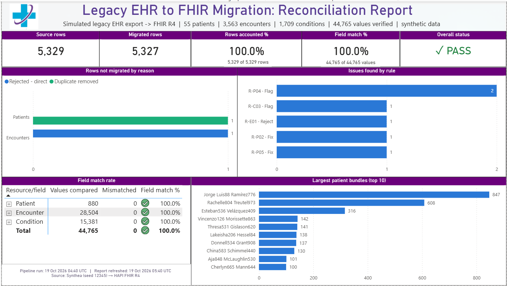
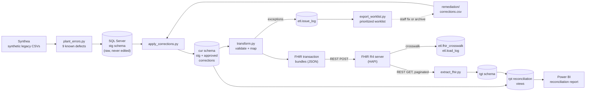
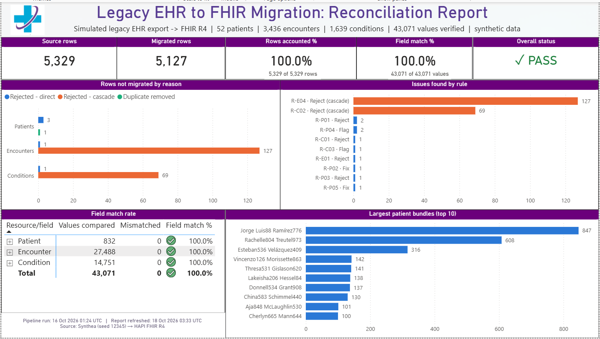

# Legacy EHR to FHIR R4 Migration and Reconciliation Pipeline

An end-to-end healthcare data migration project: extract records from a simulated legacy EHR, validate and clean them, convert them to **HL7 FHIR R4**, load them to a FHIR server over a **REST API**, read everything back, **prove with reconciliation that nothing was lost or changed**, and then **work every rejected record to a documented outcome**.

**Result:** 5,329 source rows, 100% accounted for · **5,327 migrated** (the other two: 1 duplicate removed, 1 record archived with a documented reason) · **44,765 of 44,765 field values matched** · 9 of 9 planted data defects caught, then corrected or archived.

> **Scope:** this is **Phase 1** of the migration: the core records (Patient, Encounter, Condition) that every other record depends on. Later phases are planned below in [Scope and phases](#scope-and-phases).



> **All data is synthetic.** Patients were generated with [Synthea](https://github.com/synthetichealth/synthea), and no real patient information (PHI) was used at any point. The legacy files in `data/` include SSN, driver's license and passport columns because Synthea generates them; their values are fake, and the pipeline deliberately drops these columns at ingestion (see *Data minimization* below).

---

## The problem

When a healthcare organization (a physician practice, a multi-site clinic, a hospital or an entire health system) replaces its electronic health record (EHR) system, or merges with another organization that uses a different one, years of patient history must be converted from the old system into the new one. The hard part is not moving the data. It is **proving** that every record arrived complete and correct, and explaining every record that did not.

This project simulates that conversion and answers five questions a migration team must answer before go-live:

1. Did every source row end up somewhere: migrated, rejected for a documented reason, or removed as a duplicate?
2. Were bad records caught before they reached the new system?
3. Does the target system hold exactly what was sent, field by field?
4. What happened to every rejected record: was it corrected and migrated, or archived with a reason?
5. Can the results be audited later?

---

## Architecture



**Database schemas (SQL Server `FhirMigration`)**

| Schema | Holds | Why it exists |
| --- | --- | --- |
| `stg` | Raw legacy rows exactly as received, plus `source_row` and `loaded_at` audit columns | A faithful, never-edited copy of the source |
| `cur` | Curated copy: `stg` plus approved corrections | Fixes are applied here, so the raw data stays intact |
| `etl` | Issue log, corrections audit trail, load log, legacy-ID-to-FHIR-ID crosswalk | Record of every decision, every fix and every server response |
| `tgt` | Records read back from the FHIR server, flattened to rows | What the target system actually stored |
| `rpt` | Reconciliation, remediation and reporting views | Row-level and field-level proof, the staff worklist and the dashboard's data |

---

## Pipeline steps

| Step | Script / file | What it does |
| --- | --- | --- |
| 1 | `requirements.txt` | Python environment setup |
| 2 | `src/first_call.py` | First REST API call to the FHIR server (connectivity check) |
| 3 | Synthea | Generates the synthetic legacy EHR export (seed 12345, North Carolina) |
| 4 | `src/plant_errors.py` | Plants 9 known defects and writes an answer key to `docs/` |
| 5 | `src/load_staging.py` | Loads the CSVs into SQL Server staging and drops SSN, driver's license and passport columns |
| 6 | `docs/source_to_target_mapping.xlsx` | Mapping spec: 59 field mappings, 19 validation rules, 7 design decisions |
| 7 | `src/apply_corrections.py` | Builds the curated layer (`cur`) from raw staging plus approved corrections |
| 8 | `src/transform.py` | Applies reject / fix / flag rules, builds one FHIR transaction bundle per patient |
| 9 | `src/load_fhir.py` | POSTs bundles to the server with retries; records the ID crosswalk and load log |
| 10 | `src/extract_fhir.py` | Reads every resource back by project tag, following pagination links |
| 11 | `sql/10_reconciliation.sql` | Row-level and field-level reconciliation views and reports |
| 12 | `sql/11_dashboard_views.sql`, `powerbi/` | Dashboard views and the Power BI reconciliation report |
| 13 | `src/export_worklist.py`, `sql/12_remediation.sql` | Remediation worklist for staff and the log of every correction's outcome |

---

## Results

### Row reconciliation: first pass vs. after remediation

`source rows = migrated + rejected (direct) + rejected (cascade) + duplicates removed`

| Table | Source | Migrated, first pass | Migrated, after remediation | Not migrated, and why |
| --- | ---: | ---: | ---: | --- |
| Patients | 56 | 52 | **55** | 1 duplicate removed |
| Encounters | 3,564 | 3,436 | **3,563** | 1 archived: patient cannot be identified |
| Conditions | 1,709 | 1,639 | **1,709** | none |
| **Total** | **5,329** | **5,127** | **5,327** | **2, both documented** |

On the first pass, 5 records were rejected directly, and they blocked **196 others** as cascade rejects. A *cascade* reject is a child record whose parent was rejected. For example, an encounter for a patient with no valid birth date cannot be loaded without its patient.

### Remediation

Instead of treating rejection as the end state, every rejected record was worked to a documented outcome:

| # | Problem | Records it blocked | Owner | Outcome |
| ---: | --- | ---: | --- | --- |
| 1 | Patient birth date blank | 84 | Registration | Corrected, migrated |
| 2 | Patient gender code invalid (`U`) | 63 | Registration | Corrected, migrated |
| 3 | Patient birth date blank | 49 | Registration | Corrected, migrated |
| 4 | Encounter points to a placeholder patient ID | 0 | HIM | Archived, not migrated |
| 5 | Diagnosis code blank | 0 | Coding | Corrected, migrated |

The worklist ranks problems by how many records each one blocks, so the **5 root-cause fixes released all 196 blocked records**. Every correction is recorded in `etl.corrections` with the original value, the new value, who made it, when and why.

### Field reconciliation after remediation

| Resource | Fields compared | Values compared | Mismatches | Match |
| --- | ---: | ---: | ---: | ---: |
| Patient | 16 | 880 | 0 | 100.0% |
| Encounter | 8 | 28,504 | 0 | 100.0% |
| Condition | 9 | 15,381 | 0 | 100.0% |
| **Total** | | **44,765** | **0** | **100.0%** |

**Load:** every bundle accepted, 0 failures. On the re-run, conditional create (`ifNoneExist`) recognized the records already loaded and created only the newly corrected ones, with no duplicates.

<details>
<summary>Dashboard before remediation (first pass)</summary>



</details>

---
## Scope and phases

Real EHR conversions are usually done in phases: the core records are moved and proven first, then other record types are added on top of them. This project completes **Phase 1** and proves it fully before going further.

| Phase | FHIR resources | Source data | Status |
|---|---|---|---|
| **1** | Patient, Encounter, Condition | Synthea `patients.csv`, `encounters.csv`, `conditions.csv` | **Done**: 100% of rows accounted for, 44,765 of 44,765 values matched |
| **2** | Practitioner, AllergyIntolerance, Observation, Procedure, MedicationRequest | Synthea `providers.csv`, `allergies.csv`, `observations.csv`, `procedures.csv`, `medications.csv` | Planned |
| **3** | ServiceRequest, DiagnosticReport, MedicationAdministration, Medication (as a separate resource) | Not in Synthea's CSV export; would need order, lab-result and nursing data from the source EHR | Planned |

**Why Phase 1 comes first:** every other resource points back to a patient, and most point to a visit. They cannot be loaded until those exist. This is the same dependency that causes cascade rejects in this project.

**How later phases will work:** each new resource follows the same pattern as Phase 1: map it, validate it, load it with conditional create, read it back and reconcile it. Practitioner is next, because each encounter's `PROVIDER` field already points to one.

---

## How to run it

### Prerequisites

- Windows with Python 3.12, SQL Server (Express or Developer) and SSMS
- Microsoft ODBC Driver 17 for SQL Server
- Java 17 or later (for Synthea)
- Power BI Desktop (to open the report)

### 1. Set up Python

```powershell
python -m venv .venv
.venv\Scripts\Activate.ps1
pip install -r requirements.txt
```

### 2. Check the FHIR server connection

```powershell
python src\first_call.py
```

### 3. Generate the legacy data with Synthea

```powershell
java -jar synthea-with-dependencies.jar -s 12345 -p 50 --exporter.csv.export true "North Carolina"
```

Copy `patients.csv`, `encounters.csv` and `conditions.csv` from Synthea's `output\csv` folder into `data\legacy\`.

### 4–10. Run the pipeline

```powershell
python src\plant_errors.py        # plant 9 known defects
python src\load_staging.py        # load SQL Server staging (stg)
python src\apply_corrections.py   # build the curated layer (cur)
python src\transform.py           # validate, map, build FHIR bundles
python src\load_fhir.py --limit 1 # test with one patient first
python src\load_fhir.py           # load all patients
python src\extract_fhir.py        # read everything back
```

Each script prints its own reconciliation check and a PASS / FAIL result.

### 11–12. Reconcile and report

1. In SSMS, open and run `sql\10_reconciliation.sql`, then `sql\11_dashboard_views.sql`.
2. Open `powerbi\fhir_migration_reconciliation.pbix` in Power BI Desktop and click **Refresh**.

### 13. Remediate rejected records

```powershell
python src\export_worklist.py     # writes remediation\worklist.csv, highest impact first
```

1. Fill in the last five columns of the worklist (`corrected_value`, `disposition` = Correct or Archive, `reason`, `corrected_by`, `corrected_date`) and save it as `remediation\corrections.csv`.
2. Re-run `apply_corrections.py`, `transform.py`, `load_fhir.py` and `extract_fhir.py`, then the SQL files in step 11.
3. Run `export_worklist.py` again: each correction shows **Resolved - migrated** or **Archived - not migrated**.

> **Note:** the pipeline uses the public HAPI FHIR test server (`https://hapi.fhir.org/baseR4`). It is shared and reset from time to time, so FHIR IDs will differ on every run. Only load synthetic data to a public server.

---

## Repository structure

```
fhir-migration-project/
├── data/
│   ├── legacy/              Synthea export (clean)
│   └── legacy_dirty/        Same data with 9 planted defects
├── docs/
│   ├── dashboard.png
│   ├── dashboard_before_remediation.png
│   ├── planted_errors_answer_key.csv
│   └── source_to_target_mapping.xlsx
├── powerbi/
│   ├── fhir_migration_reconciliation.pbix
│   └── fhir_migration_reconciliation_before_remediation.pbix
├── remediation/
│   ├── worklist.csv         Generated: problems ranked by impact, with owner
│   └── corrections.csv      Staff decisions: Correct or Archive, with reason
├── sql/
│   ├── 10_reconciliation.sql
│   ├── 11_dashboard_views.sql
│   └── 12_remediation.sql
├── src/
│   ├── first_call.py
│   ├── plant_errors.py
│   ├── load_staging.py
│   ├── apply_corrections.py
│   ├── transform.py
│   ├── load_fhir.py
│   ├── extract_fhir.py
│   └── export_worklist.py
├── requirements.txt
└── README.md
```

`output/` (bundles, logs, crosswalk) is created when the pipeline runs and is not stored in the repository.

---

## Design decisions worth noting

- **Stage everything as text first.** Staging columns are `NVARCHAR` so no source value is lost or silently converted before it is validated.
- **Reject, fix or flag.** Each validation rule has one documented action. Unfixable records are rejected with a rule ID, safe corrections are made and logged, and minor gaps are flagged but loaded.
- **Never edit the source.** Corrections are applied to a separate curated layer, so the raw legacy data stays intact and every change can be traced back to its original value.
- **Fix root causes, ranked by impact.** The worklist shows each direct reject once, with the number of cascade records it blocks, so staff fix the 5 problems that matter instead of 201 symptoms.
- **Every reject gets a disposition.** A record is either corrected and migrated, or archived with a reason. Nothing is silently left behind.
- **Idempotent loads.** Conditional create lets the load be rerun safely after a failure or after corrections.
- **Exact comparison.** Field reconciliation uses a binary collation and a NULL-safe comparison, and compares against the corrected values, so differences in case, whitespace or unapproved changes are not hidden.
- **Data minimization (HIPAA).** SSN, driver's license and passport numbers are dropped at ingestion because the target does not need them.
- **Auditability.** Every run records when the pipeline ran and when the report was refreshed, so each PASS is tied to a specific run.

---

## Skills demonstrated

| Area | Where |
| --- | --- |
| ETL pipeline design (Python, SQL Server) | `src/`, staging, curated and target schemas |
| REST API integration, FHIR R4 | `load_fhir.py`, `extract_fhir.py` |
| Source-to-target mapping, legacy data conversion | `docs/source_to_target_mapping.xlsx` |
| Data-quality rules, exception reporting | `transform.py`, `etl.issue_log` |
| Exception remediation workflow, audit trail | `export_worklist.py`, `apply_corrections.py`, `etl.corrections` |
| Reconciliation and validation in T-SQL | `sql/10_reconciliation.sql`, `sql/12_remediation.sql` |
| Power BI (DAX, data modeling, reporting) | `powerbi/` |
| HIPAA-aware design, audit logging | Data minimization, corrections log, load log, run timestamps |

---

**Author:** Kepha Ohanga · [LinkedIn](https://www.linkedin.com/in/kepha-ohanga-102b2141b)
