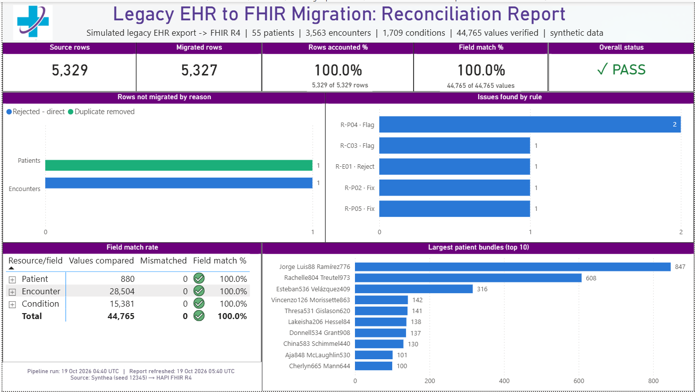
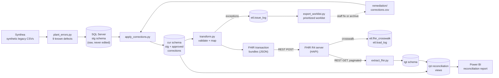
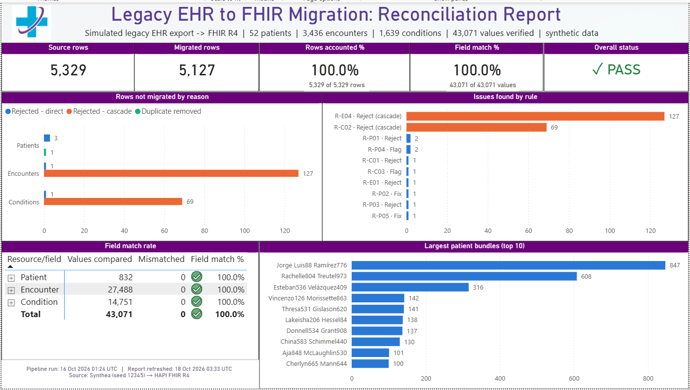

# Legacy EHR to FHIR R4 Migration and Reconciliation Pipeline

An end-to-end healthcare data migration project: extract records from a simulated legacy EHR, validate and clean them, convert them to **HL7 FHIR R4**, load them to a FHIR server over a **REST API**, read everything back, **prove with reconciliation that nothing was lost or changed**, and then **work every rejected record to a documented outcome**.

**Result, Phase 1:** 5,329 source rows, 100% accounted for · **5,327 migrated** (the other two: 1 duplicate removed, 1 record archived with a documented reason) · **44,765 of 44,765 field values matched** · 9 of 9 planted data defects caught, then corrected or archived.

**Result, Phase 2 (Practitioner):** 185 legacy provider rows, 100% accounted for · **184 migrated** (1 duplicate removed) · **2,208 of 2,208 field values matched** · 7 of 7 planted defects caught · **0 visits waiting** for a provider.

**Result, Phase 2 (clinic structure):** 1 Organization, 1 Location and **184 PractitionerRoles** (one per migrated provider) · **1,126 of 1,126 field values matched** · every role linked to its own practitioner and to the clinic · 184 of 184 specialties coded to the NUCC provider taxonomy.

**Result, Phase 2 (visit links):** all **3,563 migrated visits** updated in place to point to their practitioner, the clinic location and the clinic organization · **14,252 of 14,252 link values matched** · every visit linked to the provider in its legacy record · **Phase 1 regression test still 44,765 of 44,765**: nothing else changed.

**Result, Phase 2 (insurance):** 2,308 legacy insurance rows, 100% accounted for (current policies migrated, ended policies kept in legacy) · 9 payer Organizations and **58 Coverages** (44 primary, 14 secondary) · **558 of 558 field values matched** · 5 of 5 planted defects caught, then corrected · every migrated patient has one insurance status: 44 insured, 6 self-pay, 5 deceased.

**Result, Phase 2 (procedures):** 8,621 legacy procedure rows, 100% accounted for · **8,620 Procedures migrated** (1 duplicate removed) · **77,580 of 77,580 field values matched** · every procedure linked to its patient, its visit and that visit's practitioner · 5 of 5 planted defects caught, then corrected.

> **Scope:** **Phase 1** (Patient, Encounter, Condition) is complete. **Phase 2** has completed its clinic-structure group (Practitioner, Organization, Location, PractitionerRole), linked every visit to it, migrated each patient's current insurance (Coverage) and their procedures (Procedure). Each record now connects: patient → visit → provider → role → clinic, patient → coverage → payer, and procedure → patient, visit and performing provider. The remaining clinical resources (allergies, observations, medications) are next. Later phases are planned below in [Scope and phases](#scope-and-phases).



> **All data is synthetic.** Patients were generated with [Synthea](https://github.com/synthetichealth/synthea), and no real patient information (PHI) was used at any point. The legacy files in `data/` include SSN, driver's license and passport columns because Synthea generates them; their values are fake, and the pipeline deliberately drops these columns at ingestion (see *Data minimization* below).

---

## The problem

When a healthcare organization (a physician practice, a multi-site clinic, a hospital or an entire health system) replaces its electronic health record (EHR) system, merges with another organization that uses a different one, or joins a larger health system's shared EHR, years of patient history must be converted from the old system into the new one. The hard part is not moving the data. It is **proving** that every record arrived complete and correct, and explaining every record that did not.

This project simulates that conversion and answers five questions a migration team must answer before go-live:

1. Did every source row end up somewhere: migrated, rejected for a documented reason, or removed as a duplicate?
2. Were bad records caught before they reached the new system?
3. Does the target system hold exactly what was sent, field by field?
4. What happened to every rejected record: was it corrected and migrated, or archived with a reason?
5. Can the results be audited later?

---

## Architecture



**Database schemas (SQL Server `FhirMigration`)**

| Schema | Holds | Why it exists |
| --- | --- | --- |
| `stg` | Raw legacy rows exactly as received, plus `source_row` and `loaded_at` audit columns | A faithful, never-edited copy of the source |
| `cur` | Curated copy: `stg` plus approved corrections | Fixes are applied here, so the raw data stays intact |
| `etl` | Issue log, corrections audit trail, load log, legacy-ID-to-FHIR-ID crosswalk | Record of every decision, every fix and every server response |
| `tgt` | Records read back from the FHIR server, flattened to rows | What the target system actually stored |
| `rpt` | Reconciliation, remediation and reporting views | Row-level and field-level proof, the staff worklist and the dashboard's data |

---

## Pipeline steps

| Step | Script / file | What it does |
| --- | --- | --- |
| 1 | `requirements.txt` | Python environment setup |
| 2 | `src/first_call.py` | First REST API call to the FHIR server (connectivity check) |
| 3 | Synthea | Generates the synthetic legacy EHR export (seed 12345, North Carolina) |
| 4 | `src/plant_errors.py` | Plants 9 known defects and writes an answer key to `docs/` |
| 5 | `src/load_staging.py` | Loads the CSVs into SQL Server staging and drops SSN, driver's license and passport columns |
| 6 | `docs/source_to_target_mapping.xlsx` | Mapping spec: 59 field mappings, 19 validation rules, 7 design decisions |
| 7 | `src/apply_corrections.py` | Builds the curated layer (`cur`) from raw staging plus approved corrections |
| 8 | `src/transform.py` | Applies reject / fix / flag rules, builds one FHIR transaction bundle per patient |
| 9 | `src/load_fhir.py` | POSTs bundles to the server with retries; records the ID crosswalk and load log |
| 10 | `src/extract_fhir.py` | Reads every resource back by project tag, following pagination links |
| 11 | `sql/10_reconciliation.sql` | Row-level and field-level reconciliation views and reports |
| 12 | `sql/11_dashboard_views.sql`, `powerbi/` | Dashboard views and the Power BI reconciliation report |
| 13 | `src/export_worklist.py`, `sql/12_remediation.sql` | One remediation worklist for staff (Phase 1 and Phase 2) and the log of every correction's outcome |
| 14 | `src/plant_provider_errors.py` | Phase 2: plants 7 provider defects (misspelt and wrong names, invalid gender and NPI, duplicate) |
| 15 | `src/phase2_practitioner.py` | Phase 2: stages, applies staff corrections (curated layer), validates against the credentialing roster, loads (conditional update) and reads back Practitioners |
| 16 | `sql/20_practitioner_reconciliation.sql` | Phase 2: row, field and visit-coverage reconciliation |
| 17 | `src/phase2_clinic_structure.py`, `docs/specialty_map.csv` | Phase 2: loads the clinic Organization and Location, then one PractitionerRole per provider with the specialty mapped to the NUCC taxonomy |
| 18 | `sql/21_clinic_structure_reconciliation.sql` | Phase 2: role row reconciliation, field comparison, link integrity and specialty-coding coverage |
| 19 | `src/phase2_encounter_links.py` | Phase 2: updates every migrated Encounter in place (read, modify, write with `ifMatch`) to link it to its Practitioner, Location and Organization |
| 20 | `sql/22_encounter_link_reconciliation.sql` | Phase 2: link coverage, field comparison, correct-provider check and role consistency; then the Phase 1 reconciliation is re-run as a regression test |
| 21 | `src/plant_coverage_errors.py` | Phase 2: plants 5 insurance defects (orphan policy, unknown payer, end before start, blank member ID, overlapping policy) |
| 22 | `src/phase2_coverage.py`, `docs/payer_type_map.csv` | Phase 2: stages and curates the insurance files, loads payer Organizations, gives every legacy row one disposition, loads current Coverage (primary and secondary) with the payer type coded to the Source of Payment Typology |
| 23 | `sql/23_coverage_reconciliation.sql` | Phase 2: disposition reconciliation, coverage counts, field comparison, patient and payer link checks, and each patient's insurance status |
| 24 | `src/plant_procedure_errors.py` | Phase 2: plants 5 procedure defects (orphan visit, patient mismatch, blank code, stop before start, duplicate) |
| 25 | `src/phase2_procedure.py` | Phase 2: stages and curates procedures, validates them against the migrated visits and patients, loads Procedure (SNOMED CT) with subject, encounter and performer links |
| 26 | `sql/24_procedure_reconciliation.sql` | Phase 2: disposition reconciliation, field comparison and patient, visit and performer link checks |

---

## Results

### Row reconciliation: first pass vs. after remediation

`source rows = migrated + rejected (direct) + rejected (cascade) + duplicates removed`

| Table | Source | Migrated, first pass | Migrated, after remediation | Not migrated, and why |
| --- | ---: | ---: | ---: | --- |
| Patients | 56 | 52 | **55** | 1 duplicate removed |
| Encounters | 3,564 | 3,436 | **3,563** | 1 archived: patient cannot be identified |
| Conditions | 1,709 | 1,639 | **1,709** | none |
| **Total** | **5,329** | **5,127** | **5,327** | **2, both documented** |

On the first pass, 5 records were rejected directly, and they blocked **196 others** as cascade rejects. A *cascade* reject is a child record whose parent was rejected. For example, an encounter for a patient with no valid birth date cannot be loaded without its patient.

### Remediation

Instead of treating rejection as the end state, every rejected record was worked to a documented outcome:

| # | Problem | Records it blocked | Owner | Outcome |
| ---: | --- | ---: | --- | --- |
| 1 | Patient birth date blank | 84 | Registration | Corrected, migrated |
| 2 | Patient gender code invalid (`U`) | 63 | Registration | Corrected, migrated |
| 3 | Patient birth date blank | 49 | Registration | Corrected, migrated |
| 4 | Encounter points to a placeholder patient ID | 0 | HIM | Archived, not migrated |
| 5 | Diagnosis code blank | 0 | Coding | Corrected, migrated |

The worklist ranks problems by how many records each one blocks, so the **5 root-cause fixes released all 196 blocked records**. Every correction is recorded in `etl.corrections` with the original value, the new value, who made it, when and why.

### Field reconciliation after remediation

| Resource | Fields compared | Values compared | Mismatches | Match |
| --- | ---: | ---: | ---: | ---: |
| Patient | 16 | 880 | 0 | 100.0% |
| Encounter | 8 | 28,504 | 0 | 100.0% |
| Condition | 9 | 15,381 | 0 | 100.0% |
| **Total** | | **44,765** | **0** | **100.0%** |

**Load:** every bundle accepted, 0 failures. On the re-run, conditional create (`ifNoneExist`) recognized the records already loaded and created only the newly corrected ones, with no duplicates.

<details>
<summary>Dashboard before remediation (first pass)</summary>



</details>

### Phase 2, step 1: Practitioner (providers)

Provider names were checked against a credentialing roster, the trusted source for provider data. Seven realistic defects were planted in the legacy provider export. Practitioner then went through the same remediation workflow as Phase 1, using the same worklist, the same `corrections.csv` and the same audit trail.

| Check | First pass | After remediation |
|---|---|---|
| Row reconciliation | 185 = 183 migrated + 1 rejected + 1 duplicate removed: **PASS** | 185 = **184 migrated + 0 rejected** + 1 duplicate removed: **PASS** |
| Planted defects | **7 of 7 caught** | **7 of 7 caught** (3 fixed automatically, 3 corrected by staff, 1 duplicate removed) |
| Field reconciliation | 2,196 of 2,196 values matched | **2,208 of 2,208** values matched (12 fields, including NPI) |
| Visit coverage | 2 visits waiting for the rejected provider | **0 visits waiting**: every provider used by a migrated visit is on the server |

**Two kinds of fixes.** Small, high-confidence errors are fixed automatically; uncertain ones go to a person:

| Problem | How it was found | Who fixed it | Outcome |
|---|---|---|---|
| 3 misspelt names (letters swapped, missing, doubled) | Similarity to the roster name 0.95–0.98, above the 0.85 threshold | Pipeline, automatically (logged as R-PR02 Fix) | Roster spelling used, migrated |
| 1 name belonging to a different provider | Similarity 0.14: possibly the wrong person, so the pipeline refused to guess | Credentialing (staff correction) | Name confirmed, migrated; its 2 visits now link to it |
| 1 invalid gender code (`X`) | Not M or F | Credentialing (staff correction) | Corrected from the credentialing file, migrated |
| 1 invalid NPI (9 digits) | Not 10 digits | Credentialing (staff correction) | Corrected from the credentialing file, migrated |
| 1 duplicate row | Same provider ID twice | Pipeline, automatically (R-PR04 Fix) | First copy kept |

The NPI is stored as the provider's official identifier (`http://hl7.org/fhir/sid/us-npi`). Loads use **conditional update**: the re-run after remediation created exactly 1 practitioner (the released one) and updated the other 183 in place, with no duplicates.

### Phase 2, step 2: Clinic structure (Organization, Location, PractitionerRole)

**Practitioner** says *who* a provider is (name, NPI). **PractitionerRole** says *where and as what* they work: this clinic, this location, this specialty. Keeping the two apart means a provider who works in more than one place is still one person with several roles, never a duplicate record.

| Check | Result |
|---|---|
| Row reconciliation | 184 distinct providers = **184 roles** + 0 rejected; roles = migrated practitioners; 1 Organization; 1 Location: **PASS** |
| Field reconciliation | Organization 10 of 10, Location 12 of 12, PractitionerRole 1,104 of 1,104: **1,126 of 1,126** values matched |
| Link integrity | Every role points to the practitioner migrated **from the same legacy provider** (not just any practitioner), and to the clinic's Organization and Location: **184 of 184 OK** for each link |
| Specialty coding | Legacy free text mapped to the **NUCC provider taxonomy** through `docs/specialty_map.csv`; unmapped values would load as text and be flagged. Profiling showed all 184 providers are `GENERAL PRACTICE` → `208D00000X`: **184 of 184 coded**, 0 flags |
| Legacy organizations | 184 legacy organization values documented as **not migrated** (one-clinic decision, below) |

The clinic's name, address and phone number are **fictional** reference data defined in the script, since all data in this project is synthetic.

### Phase 2, step 3: Linking visits to providers and the clinic

The Phase 1 encounters were loaded before any Practitioner existed, so they did not yet say **who** saw the patient or **where**. Rather than reloading them, each encounter was **updated in place**:

1. **Read** the encounter exactly as the server holds it.
2. **Modify** only three fields: `participant` (the Practitioner, as primary performer), `location` (the clinic Location) and `serviceProvider` (the clinic Organization). Every other field is left untouched.
3. **Write** it back with `ifMatch` on the version just read (*optimistic locking*): the server saves it only if nobody changed the encounter in between, so no other change can be overwritten unnoticed.

The provider comes from the legacy encounter's `PROVIDER` column, translated to the FHIR Practitioner through the practitioner crosswalk.

| Check | Result |
|---|---|
| Coverage | **3,563 of 3,563** migrated visits fully linked; 0 without a provider: **PASS** |
| Field reconciliation | **14,252 of 14,252** link values matched (3,563 visits × 4 link fields) |
| Correct provider | Every visit points to the practitioner migrated from the provider **in its own legacy record**: 0 wrong links |
| Cross-resource consistency | **3,563 of 3,563** visits: the visit's practitioner holds a PractitionerRole at the visit's location |
| **Regression test** | Phase 1 re-extracted and re-reconciled afterwards: still **44,765 of 44,765** values matched and every row accounted for, proving the update changed only the links |

The Practitioner remediation mattered here: without it, the 2 visits of the provider rejected for a wrong name would have had no practitioner to link to.

### Phase 2, step 4: Insurance (payer Organization, Coverage)

**Coverage** is a patient's insurance policy: who pays (the payer), the member ID, the policy dates, the patient's relationship to the policy holder, and whether it is primary or secondary. It is what is verified at check-in and billed on a claim, so errors here become denied claims later.

**Current coverage only.** The legacy file holds every policy each patient ever had (Synthea writes a new row at each yearly renewal). As in most conversions, only the policy **in force on the extract date** is migrated; ended policies stay in the legacy system and are **counted, not lost**. Profiling showed that Synthea creates each yearly policy in advance (end dates are often in the future), so the extract date is the **latest policy start** in the file (2026-10-10). A policy is current if it started at or before that moment and ends **after** it, so at a renewal only the new policy counts.

Every legacy row gets **exactly one disposition**:

| Disposition | Rows |
|---|---:|
| Ended: kept in legacy | 2,257 |
| Current: migrated | 44 |
| Current: self-pay (`NO_INSURANCE`, so no Coverage is created) | 6 |
| Superseded (older of two overlapping current rows) | 1 |
| Rejected | 0 (3 on the first pass, all remediated) |
| **Total** | **2,308**: **PASS** |

| Check | Result |
|---|---|
| Coverage | **44 primary + 14 secondary = 58** Coverages (coordination of benefits); 9 payer Organizations (`NO_INSURANCE` is not a payer and is not migrated) |
| Field reconciliation | Coverage 522 of 522, payer Organization 36 of 36: **558 of 558** values matched |
| Link integrity | Every Coverage points to the patient migrated from its legacy `PATIENT` and the payer migrated from its legacy `PAYER`: **58 of 58 OK** |
| Payer type | Coded to the US **Source of Payment Typology** through `docs/payer_type_map.csv` (Medicare 1, Medicaid 2, dual eligible 14, private 5) |
| Patient view | All 55 migrated patients have one insurance status: **44 active coverage, 6 self-pay, 5 deceased** |

**Remediation.** The 3 rejects and 1 flag joined the shared worklist, owned by Patient Access:

| Problem | Owner | Outcome |
|---|---|---|
| Policy attached to a placeholder patient (it made a real, insured patient look uninsured) | Patient Access / Registration | Patient identified, corrected, migrated |
| Unknown payer | Patient Access / Insurance Verification | Payer confirmed by eligibility check, corrected, migrated |
| End date before start date | Patient Access / Insurance Verification | Dates confirmed, corrected, migrated |
| Blank member ID (a claim would need it) | Patient Access / Insurance Verification | Member ID from the insurance card, corrected |
| Overlapping current policy | Pipeline, automatically (R-CV04 Fix) | Older row superseded |

The re-run created exactly the 3 released Coverages and updated the other 55 in place. **Not migrated, by design:** `OWNER_NAME` (another person's name; data minimization) and the simulator's payer statistics columns.

### Phase 2, step 5: Procedures

Each **Procedure** records something done for a patient during a visit: the SNOMED CT code, when it was done, why (reason code), and who did it. Profiling showed all 8,620 legacy procedures are coded in **SNOMED CT**, so no code mapping was needed.

| Legacy | FHIR Procedure |
|---|---|
| `CODE`, `DESCRIPTION`, `SYSTEM` | `code` (SNOMED CT) |
| `PATIENT` | `subject`: must be the **same patient as the visit's** |
| `ENCOUNTER` | `encounter`: the visit must have been migrated |
| `START`, `STOP` | `performedPeriod` |
| `REASONCODE`, `REASONDESCRIPTION` | `reasonCode` |
| *(derived)* | `performer`: the practitioner linked to the visit in step 3 |
| `BASE_COST` | **Not migrated**: cost is billing data, not the clinical record (open balances stay in legacy; see *Billing and balances*) |

| Check | Result |
|---|---|
| Row reconciliation | 8,621 rows = **8,620 migrated** + 1 duplicate removed + 0 rejected: **PASS**; all 8,620 confirmed on the server |
| Field reconciliation | **77,580 of 77,580** values matched (8,620 procedures × 9 fields) |
| Link integrity | **8,620 of 8,620** procedures point to the right patient, the right visit, and the practitioner linked to that visit |
| Cascade | A procedure whose visit was archived stays with its visit in the legacy archive (0 in this data: the archived visit had no procedures) |

**Remediation.** The 4 rejects joined the shared worklist:

| Problem | Owner | Outcome |
|---|---|---|
| Procedure points to a visit that does not exist | HIM | Visit identified from the visit history, corrected, migrated |
| Procedure filed under the **wrong patient** (a tubal ligation on a male patient's record) | HIM | Patient confirmed against the visit record, corrected, migrated |
| Procedure code blank | Coding | SNOMED CT code confirmed against the procedure documentation, corrected, migrated |
| Stop time before start time | HIM | End time confirmed against the clinical record, corrected, migrated |
| Duplicate procedure row | Pipeline, automatically (R-PC06 Fix) | First copy kept |

**The rules also checked the corrections.** One correction first pointed a procedure to another patient's visit. Patient and visit IDs in this data share a prefix per patient, so the mistake was visible before the re-run; had it been applied, the patient-mismatch rule (R-PC03) would have rejected it again and the worklist would have shown it as still failing.

---
## Scope and phases

Real EHR conversions are usually done in phases: the core records are moved and proven first, then other record types are added on top of them. This project completes **Phase 1** and proves it fully before going further. **Phase 2** has started: Practitioner (complete and remediated), the clinic structure, the visit links, insurance and procedures (each complete and remediated) are done.

| Phase | FHIR resources | Source data | Status |
|---|---|---|---|
| **1** | Patient, Encounter, Condition | Synthea `patients.csv`, `encounters.csv`, `conditions.csv` | **Done**: 100% of rows accounted for, 44,765 of 44,765 values matched |
| **2** | **Clinic structure:** Practitioner, PractitionerRole, Organization, Location<br>**Insurance:** Coverage<br>**Clinical:** AllergyIntolerance, Observation, Procedure, MedicationRequest | Synthea `providers.csv`, `organizations.csv`, `payers.csv`, `payer_transitions.csv`, `allergies.csv`, `observations.csv`, `procedures.csv`, `medications.csv` | **In progress:** Practitioner done (185 rows → 184 migrated, 1 duplicate removed; 2,208 of 2,208 values matched). Clinic structure done (1 Organization, 1 Location, 184 PractitionerRoles; 1,126 of 1,126 values matched). All 3,563 visits linked to provider and clinic (14,252 of 14,252). Coverage done (2,308 rows accounted for; 58 Coverages; 558 of 558 values matched). Procedure done (8,620 migrated; 77,580 of 77,580 values matched). AllergyIntolerance, Observation and MedicationRequest next |
| **3** | **Scheduling:** Appointment<br>**Referrals and orders:** ServiceRequest<br>**Prior authorization:** Claim (use = preauthorization), ClaimResponse<br>**Documents and results:** DocumentReference, DiagnosticReport<br>**Medications:** MedicationAdministration, Medication (as a separate resource) | Not in Synthea's CSV export; would need synthetic data or the source EHR's scheduling, referral, authorization, document, lab and nursing data | Planned |

**Why Phase 1 comes first:** every other resource points back to a patient, and most point to a visit. They cannot be loaded until those exist. This is the same dependency that causes cascade rejects in this project.

**Why Phase 2 adds clinic structure and insurance:** scheduling and billing depend on them. Appointments need the provider, department and location they belong to (Practitioner, PractitionerRole, Organization, Location). Pre-registration and clean claims need the patient's insurance (Coverage).

**Why Phase 3 adds appointments, referrals and authorizations:** these are the "open work" a clinic must carry across on go-live day: future appointments, referrals still in progress, and prior authorizations already approved or pending. A missing prior authorization is a leading cause of claim denials, so authorizations must not be lost in the switch.

**How later phases will work:** each new resource follows the same pattern as Phase 1: map it, validate it, load it with conditional create or update, read it back, reconcile it and work every reject to a documented outcome. Practitioner came first because each encounter's `PROVIDER` field already points to a provider. The clinic structure followed, modeled as **one clinic** (see *Design decisions*): one Organization, one Location, and one PractitionerRole per migrated provider. The Phase 1 encounters were then updated in place so each visit points to its practitioner, the clinic location and the clinic organization, and a regression test confirmed Phase 1 was otherwise unchanged. Insurance (**Coverage**) followed, because pre-registration and clean claims depend on it: each patient's current policy, primary and secondary, with ended policies counted and kept in legacy. Procedures followed, the first clinical resource: each points to its patient, its visit and the visit's practitioner. AllergyIntolerance, Observation and MedicationRequest come next, using the same pattern.

### Billing and balances

FHIR has separate financial resources (Account, ChargeItem, Claim, ClaimResponse, ExplanationOfBenefit, PaymentReconciliation, Invoice). In a real conversion, however, open charges and balances are usually **not** migrated. Claims from before go-live are worked to zero in the old billing system (**A/R runout**), and new charges start in the new system. This avoids double billing and broken payment histories.

Planned for this project:

- **A/R runout report:** legacy open balances by payer and by age (0–30, 31–60, 61–90, 90+ days), tracked until they reach zero.
- **Optional billing history:** load Synthea's `claims.csv` and `claims_transactions.csv` as read-only **ExplanationOfBenefit** resources, so past billing is visible. This is history, not open balances.
- **Closed claims only:** if billing history is loaded, only claims that are **closed** in the legacy system move: paid, adjusted to a zero balance, or final-denied and written off (for example, after the timely filing limit). A claim that is still open, such as one denied for a credentialing issue while the appeal or rebilling window is still open, stays in the legacy system until it closes. A reconciliation check confirms that no open balance was migrated.
- **A migration reject is not a payer denial:** a record rejected by this pipeline (for example, a provider whose name does not match the credentialing roster) has a **data** problem that is fixed or archived. It does not change whether any claim is paid.

### Next: converting into a system that already has data

Phase 1 loads into an **empty** FHIR server. Many real conversions are different: a practice joining a larger health system's shared EHR (for example, an Epic Community Connect arrangement) moves into a system that **already holds** many of the same patients and providers. The next steps make the project reflect that. They are planned work, not yet built.

| Step | What changes | Why it matters |
|---|---|---|
| **1. Patient matching** | Pre-load "existing" patients on the server, some of them the same people as legacy patients with realistic differences (nickname, typo, new address). Before loading, match each legacy patient on name, birth date, sex, address and phone: **confident match** → link to the existing record; **possible match** → send to an HIM review worklist; **no match** → create a new patient. | Linking to the existing record prevents duplicate charts. Sending uncertain matches to a person prevents **overlays** (two different people merged into one chart). |
| **2. Provider matching by NPI** | Pre-load "existing" providers on the server, then match each legacy provider by NPI (already migrated as the official identifier) and link to the existing record instead of creating a new one, using a crosswalk from legacy provider ID to NPI to target provider. | Every encounter and appointment points to a provider. A missing or wrong provider breaks scheduling and billing. |
| **3. Appointment conversion** | Add synthetic future appointments (FHIR Appointment) with a **visit-type mapping table** (legacy type → new type) and a report comparing appointment counts per provider per day, old vs. new. | Schedulers need to check converted schedules before go-live. A count report shows them exactly where to look. |
| **4. Mock conversion tracking** | Add a `run_id` to the load and issue logs, and a view comparing runs (for example, Mock 1: 9 issues → Mock 2: 4 → Mock 3: 0). | Real conversions are rehearsed several times. Tracking each run shows the data getting cleaner before go-live. |
| **5. Conversion cut-off rule** | Convert active and recent data (for example, the last 3 years), and report older history as **kept in the legacy system**, not missing. | When the old systems stay available for historical data, not everything needs to move. The reconciliation must still account for every row. |

**Reconciliation stays the same idea:** for patients, *linked + created + under review = all legacy patients*, with no unexplained rows.

---

## How to run it

### Prerequisites

- Windows with Python 3.12, SQL Server (Express or Developer) and SSMS
- Microsoft ODBC Driver 17 for SQL Server
- Java 17 or later (for Synthea)
- Power BI Desktop (to open the report)

### 1. Set up Python

```powershell
python -m venv .venv
.venv\Scripts\Activate.ps1
pip install -r requirements.txt
```

### 2. Check the FHIR server connection

```powershell
python src\first_call.py
```

### 3. Generate the legacy data with Synthea

```powershell
java -jar synthea-with-dependencies.jar -s 12345 -p 50 --exporter.csv.export true "North Carolina"
```

Copy `patients.csv`, `encounters.csv`, `conditions.csv` and `providers.csv` from Synthea's `output\csv` folder into `data\legacy\`. The clean `providers.csv` also serves as the credentialing roster in Phase 2.

### 4–10. Run the pipeline

```powershell
python src\plant_errors.py        # plant 9 known defects
python src\load_staging.py        # load SQL Server staging (stg)
python src\apply_corrections.py   # build the curated layer (cur)
python src\transform.py           # validate, map, build FHIR bundles
python src\load_fhir.py --limit 1 # test with one patient first
python src\load_fhir.py           # load all patients
python src\extract_fhir.py        # read everything back
```

Each script prints its own reconciliation check and a PASS / FAIL result.

### 11–12. Reconcile and report

1. In SSMS, open and run `sql\10_reconciliation.sql`, then `sql\11_dashboard_views.sql`.
2. Open `powerbi\fhir_migration_reconciliation.pbix` in Power BI Desktop and click **Refresh**.

### 13. Remediate rejected records

```powershell
python src\export_worklist.py     # writes remediation\worklist.csv, highest impact first
```

1. Copy the **Open** rows of the worklist into `remediation\corrections.csv`, **below any rows already there**, and fill in the last five columns (`corrected_value`, `disposition` = Correct or Archive, `reason`, `corrected_by`, `corrected_date`). Take every value from the source of truth (registration record, clinical record or credentialing file). Never replace the file with the worklist: earlier decisions live in it.
2. Re-run `apply_corrections.py`, `transform.py`, `load_fhir.py` and `extract_fhir.py`, then the SQL files in step 11. For providers, re-run `phase2_practitioner.py` (it applies the corrections itself).
3. Run `export_worklist.py` again: each correction shows **Resolved - migrated** or **Archived - not migrated**.

> Close `worklist.csv` and `corrections.csv` in Excel before running the scripts: Windows locks a file that Excel has open.

### 14–16. Phase 2: Practitioner

```powershell
python src\plant_provider_errors.py               # plant 7 provider defects + answer key
python src\phase2_practitioner.py --limit 1       # test with one bundle first
python src\phase2_practitioner.py                 # stage, curate, validate, load, read back
```

Then open `sql\20_practitioner_reconciliation.sql` in SSMS and press **F5**, and run `export_worklist.py` to see provider problems on the shared worklist.

### 17–18. Phase 2: Clinic structure

```powershell
python src\phase2_clinic_structure.py --limit 1   # clinic + one bundle of roles (a test)
python src\phase2_clinic_structure.py             # clinic + all roles, then read back
```

Then open `sql\21_clinic_structure_reconciliation.sql` in SSMS and press **F5**. Run this step after Practitioner: every role points to a migrated practitioner.

### 19–20. Phase 2: Visit links

```powershell
python src\phase2_encounter_links.py --limit 1    # one bundle of 50 encounters (a test)
python src\phase2_encounter_links.py              # all encounters, then read back
```

1. Open `sql\22_encounter_link_reconciliation.sql` in SSMS and press **F5**.
2. **Regression test:** run `python src\extract_fhir.py`, then `sql\10_reconciliation.sql`. Phase 1 must still show every value matched.

Run this step after the clinic structure: each visit points to the clinic's Location and Organization.

### 21–23. Phase 2: Insurance

Copy `payers.csv` and `payer_transitions.csv` from Synthea's `output\csv` folder into `data\legacy\`, then:

```powershell
python src\plant_coverage_errors.py           # plant 5 insurance defects + answer key
python src\phase2_coverage.py --limit 1       # payers + one bundle of Coverage (a test)
python src\phase2_coverage.py                 # everything, then read back
```

Open `sql\23_coverage_reconciliation.sql` in SSMS and press **F5**, and run `export_worklist.py`: insurance problems appear on the shared worklist and are fixed through `corrections.csv` like any other.

### 24–26. Phase 2: Procedures

Copy `procedures.csv` from Synthea's `output\csv` folder into `data\legacy\`, then:

```powershell
python src\plant_procedure_errors.py          # plant 5 procedure defects + answer key
python src\phase2_procedure.py --limit 1      # one bundle of 50 (a test)
python src\phase2_procedure.py                # everything (about 170 bundles, 6-8 minutes)
```

Open `sql\24_procedure_reconciliation.sql` in SSMS and press **F5**, then run `export_worklist.py`.

> **Tip for corrections:** type long codes (for example 15-digit SNOMED CT codes) in a text editor, not Excel. Excel turns long numbers into scientific notation and can save them that way.

> **Note:** the pipeline uses the public HAPI FHIR test server (`https://hapi.fhir.org/baseR4`). It is shared and reset from time to time, so FHIR IDs will differ on every run. Only load synthetic data to a public server.

---

## Repository structure

```
fhir-migration-project/
├── data/
│   ├── legacy/              Synthea export (clean); providers.csv is also the credentialing roster
│   └── legacy_dirty/        Same data with planted defects (9 in Phase 1, 7 in providers.csv,
│                            5 in payer_transitions.csv, 5 in procedures.csv)
├── docs/
│   ├── dashboard.png
│   ├── dashboard_before_remediation.png
│   ├── planted_errors_answer_key.csv
│   ├── planted_provider_errors_answer_key.csv
│   ├── planted_coverage_errors_answer_key.csv
│   ├── planted_procedure_errors_answer_key.csv
│   ├── payer_type_map.csv   Payer name -> Source of Payment Typology code
│   ├── source_to_target_mapping.xlsx
│   └── specialty_map.csv    Legacy specialty text -> NUCC provider taxonomy code
├── powerbi/
│   ├── fhir_migration_reconciliation.pbix
│   └── fhir_migration_reconciliation_before_remediation.pbix
├── remediation/
│   ├── worklist.csv         Generated: problems ranked by impact, with owner
│   └── corrections.csv      Staff decisions: Correct or Archive, with reason
├── sql/
│   ├── 10_reconciliation.sql
│   ├── 11_dashboard_views.sql
│   ├── 12_remediation.sql
│   ├── 20_practitioner_reconciliation.sql
│   ├── 21_clinic_structure_reconciliation.sql
│   ├── 22_encounter_link_reconciliation.sql
│   ├── 23_coverage_reconciliation.sql
│   ├── 24_procedure_reconciliation.sql
│   └── diagnosis_count_check.sql   Data profiling: distinct diagnoses per patient, with the list (raw stg data)
├── src/
│   ├── first_call.py
│   ├── plant_errors.py
│   ├── load_staging.py
│   ├── apply_corrections.py
│   ├── transform.py
│   ├── load_fhir.py
│   ├── extract_fhir.py
│   ├── export_worklist.py
│   ├── plant_provider_errors.py
│   ├── phase2_practitioner.py
│   ├── phase2_clinic_structure.py
│   ├── phase2_encounter_links.py
│   ├── plant_coverage_errors.py
│   ├── phase2_coverage.py
│   ├── plant_procedure_errors.py
│   └── phase2_procedure.py
├── requirements.txt
└── README.md
```

`output/` (bundles, logs, crosswalk) is created when the pipeline runs and is not stored in the repository.

---

## Design decisions worth noting

- **Stage everything as text first.** Staging columns are `NVARCHAR` so no source value is lost or silently converted before it is validated.
- **Reject, fix or flag.** Each validation rule has one documented action. Unfixable records are rejected with a rule ID, safe corrections are made and logged, and minor gaps are flagged but loaded.
- **Never edit the source.** Corrections are applied to a separate curated layer, so the raw legacy data stays intact and every change can be traced back to its original value.
- **Fix root causes, ranked by impact.** The worklist shows each direct reject once, with the number of cascade records it blocks, so staff fix the 5 problems that matter instead of 201 symptoms.
- **Every reject gets a disposition.** A record is either corrected and migrated, or archived with a reason. Nothing is silently left behind.
- **Automatic fix or human review, decided by confidence.** A provider name within 0.85 similarity of the credentialing roster is treated as a typo and fixed automatically; anything less alike could be a different person, so it is rejected and routed to Credentialing rather than guessed.
- **One worklist, one audit trail.** Provider problems join the same worklist and `etl.corrections` log as Phase 1, so staff work from a single list for the whole migration.
- **Idempotent loads.** Conditional create (Phase 1) and conditional update (Practitioner) let the load be rerun safely after a failure or after corrections, without duplicates.
- **One clinic.** Synthea assigns each provider to their own organization (184 providers, 184 organizations, at most 1 provider per organization, verified in SQL). These values are simulator artifacts, so all providers are mapped to a single clinic Organization and Location. Legacy organization IDs are kept in `stg`/`cur` for audit only.
- **Profile before mapping.** Specialty values were profiled in SQL before the code mapping was finalized (all 184 providers are `GENERAL PRACTICE`). The mapping lives in a reviewable table (`docs/specialty_map.csv`), not in code, and any value missing from it is loaded as text and flagged rather than dropped.
- **Every row gets one disposition.** Under the current-coverage-only rule, most legacy insurance rows are not migrated, so each one is given exactly one outcome (ended, current migrated, self-pay, superseded or rejected) and the totals must add up to the source rows. "Not migrated" never means "unexplained".
- **Profiling overturned an assumption.** The first definition of "current coverage" used the latest end date and found only 1 insured patient. Profiling showed Synthea renews policies a year in advance, so the extract date was redefined as the latest policy start, with a half-open date range so a renewal is not mistaken for an overlap.
- **Child records follow their parent.** A procedure is checked against its visit: the visit must be migrated, and the procedure's patient must be the visit's patient. If the visit was archived, the procedure stays with it in the legacy archive (a cascade), so a chart is never split between systems.
- **Update in place, never reload.** Records already migrated and proven are changed with read, modify, write and `ifMatch` (optimistic locking), touching only the new fields.
- **Regression testing.** After any change to migrated records, the earlier reconciliation is re-run; Phase 1 still matched 44,765 of 44,765 after the visit links were added.
- **Prove links, not just counts.** The clinic-structure reconciliation checks that each role points to the practitioner migrated from the *same* legacy provider, so a role attached to the wrong person would fail even if every count matched.
- **Exact comparison.** Field reconciliation uses a binary collation and a NULL-safe comparison, and compares against the corrected values, so differences in case, whitespace or unapproved changes are not hidden.
- **Data minimization (HIPAA).** SSN, driver's license and passport numbers are dropped at ingestion because the target does not need them.
- **Auditability.** Every run records when the pipeline ran and when the report was refreshed, so each PASS is tied to a specific run.

---

## Skills demonstrated

| Area | Where |
| --- | --- |
| ETL pipeline design (Python, SQL Server) | `src/`, staging, curated and target schemas |
| REST API integration, FHIR R4 | `load_fhir.py`, `extract_fhir.py` |
| Source-to-target mapping, legacy data conversion | `docs/source_to_target_mapping.xlsx` |
| Data-quality rules, exception reporting | `transform.py`, `phase2_practitioner.py`, `etl.issue_log` |
| Validation against a reference source (fuzzy name matching) | `phase2_practitioner.py` (credentialing roster, similarity threshold) |
| Code mapping to national terminologies (NUCC provider taxonomy, Source of Payment Typology) | `docs/specialty_map.csv`, `docs/payer_type_map.csv` |
| Insurance data conversion (primary/secondary coverage, conversion cut-off, eligibility-based remediation) | `phase2_coverage.py`, `sql/23_coverage_reconciliation.sql` |
| Clinical data conversion (SNOMED CT procedures, patient-visit consistency, performer derivation) | `phase2_procedure.py`, `sql/24_procedure_reconciliation.sql` |
| Referential integrity across FHIR resources | `sql/21_clinic_structure_reconciliation.sql`, `sql/22_encounter_link_reconciliation.sql` (visit → practitioner → role → clinic) |
| Safe updates to live records (optimistic locking), regression testing | `phase2_encounter_links.py` (`ifMatch`), Phase 1 reconciliation re-run |
| Exception remediation workflow, audit trail | `export_worklist.py`, `apply_corrections.py`, `etl.corrections` |
| Reconciliation and validation in T-SQL | `sql/10_reconciliation.sql`, `sql/12_remediation.sql`, `sql/20_practitioner_reconciliation.sql`, `sql/21_clinic_structure_reconciliation.sql`, `sql/22_encounter_link_reconciliation.sql`, `sql/23_coverage_reconciliation.sql`, `sql/24_procedure_reconciliation.sql` |
| Power BI (DAX, data modeling, reporting) | `powerbi/` |
| HIPAA-aware design, audit logging | Data minimization, corrections log, load log, run timestamps |

---

**Author:** Kepha Ohanga · [LinkedIn](https://www.linkedin.com/in/kepha-ohanga-102b2141b)
