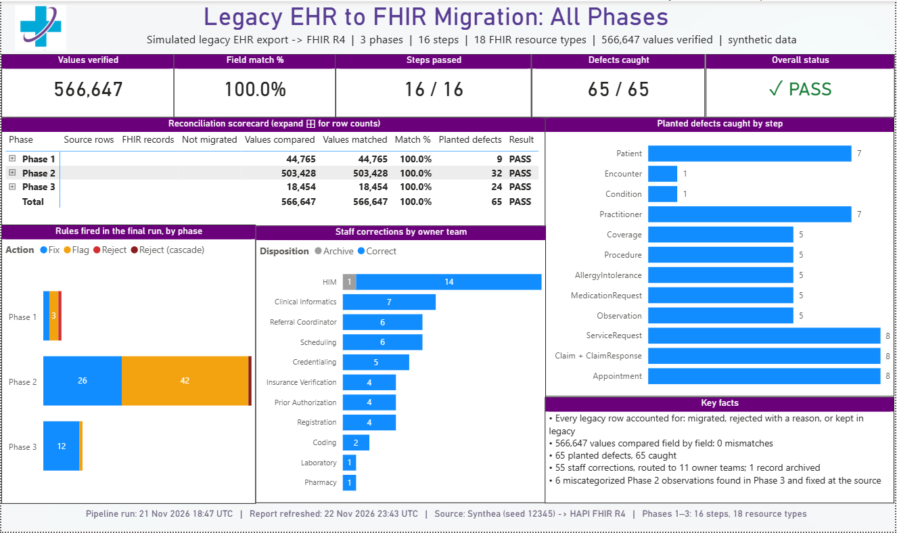
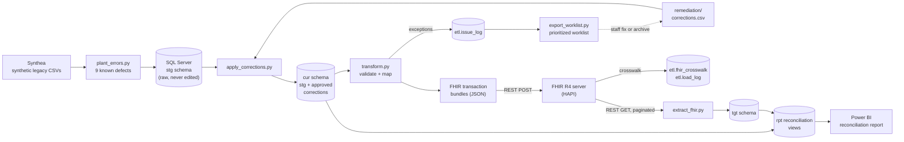
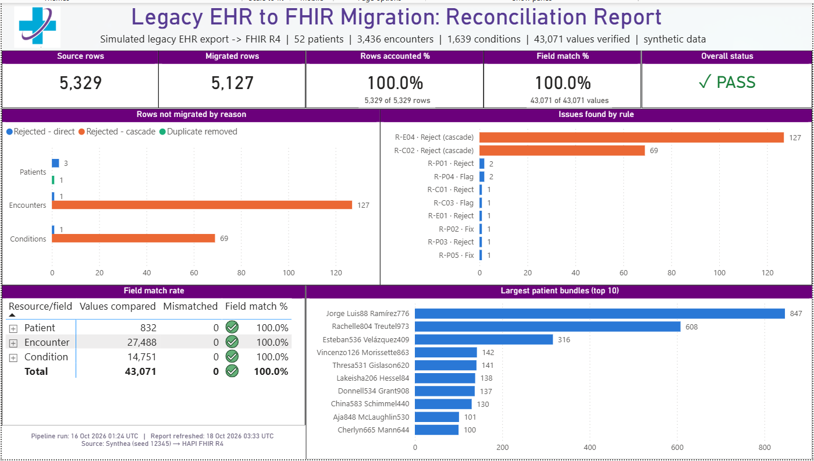

# Legacy EHR to FHIR R4 Migration and Reconciliation Pipeline

An end-to-end healthcare data migration project: extract records from a simulated legacy EHR, validate and clean them, convert them to **HL7 FHIR R4**, load them to a FHIR server over a **REST API**, read everything back, **prove with reconciliation that nothing was lost or changed**, and then **work every rejected record to a documented outcome**.

**Result, Phase 1:** 5,329 source rows, 100% accounted for · **5,327 migrated** (the other two: 1 duplicate removed, 1 record archived with a documented reason) · **44,765 of 44,765 field values matched** · 9 of 9 planted data defects caught, then corrected or archived.

**Result, Phase 2 (Practitioner):** 185 legacy provider rows, 100% accounted for · **184 migrated** (1 duplicate removed) · **2,208 of 2,208 field values matched** · 7 of 7 planted defects caught · **0 visits waiting** for a provider.

**Result, Phase 2 (clinic structure):** 1 Organization, 1 Location and **184 PractitionerRoles** (one per migrated provider) · **1,126 of 1,126 field values matched** · every role linked to its own practitioner and to the clinic · 184 of 184 specialties coded to the NUCC provider taxonomy.

**Result, Phase 2 (visit links):** all **3,563 migrated visits** updated in place to point to their practitioner, the clinic location and the clinic organization · **14,252 of 14,252 link values matched** · every visit linked to the provider in its legacy record · **Phase 1 regression test still 44,765 of 44,765**: nothing else changed.

**Result, Phase 2 (insurance):** 2,308 legacy insurance rows, 100% accounted for (current policies migrated, ended policies kept in legacy) · 9 payer Organizations and **58 Coverages** (44 primary, 14 secondary) · **558 of 558 field values matched** · 5 of 5 planted defects caught, then corrected · every migrated patient has one insurance status: 44 insured, 6 self-pay, 5 deceased.

**Result, Phase 2 (procedures):** 8,621 legacy procedure rows, 100% accounted for · **8,620 Procedures migrated** (1 duplicate removed) · **77,580 of 77,580 field values matched** · every procedure linked to its patient, its visit and that visit's practitioner · 5 of 5 planted defects caught, then corrected.

**Result, Phase 2 (allergies):** 67 legacy allergy rows, 100% accounted for · **66 AllergyIntolerances migrated** (1 duplicate removed) · **1,122 of 1,122 field values matched** · every allergy and reaction coded with a **confirmed** code system (62 SNOMED CT, 4 RxNorm medication allergies) · 5 of 5 planted defects caught, then corrected.

**Result, Phase 2 (medications):** 2,826 legacy prescription rows, 100% accounted for · **2,824 MedicationRequests migrated** with full history (158 active, 2,666 completed) · **31,064 of 31,064 field values matched** · RxNorm codes confirmed by the source's data dictionary · a too-broad duplicate rule was caught by profiling and fixed, recovering **8 real prescriptions (1 active)** · 5 of 5 planted defects caught, then corrected.

**Result, Phase 2 (observations):** 35,773 legacy observation rows, 100% accounted for · **34,138 Observations migrated** (vital signs, lab results, surveys) with full history · **375,518 of 375,518 field values matched** · 1,617 simulator statistics counted and not migrated · 112 SNOMED CT and 16 local codes kept that a LOINC-only rule would have rejected · reconciliation query optimized from **over 50 minutes to 4 seconds** with indexes.

**Result, Phase 3 (referrals):** 38 legacy referral rows, 100% accounted for · **37 ServiceRequests migrated** (1 duplicate removed) · **481 of 481 field values matched** · every referral linked to its patient and referring provider, with its diagnosis confirmed on the patient's problem list · the legacy status kept even where FHIR has no matching code · 8 of 8 planted defects caught, then corrected.

**Result, Phase 3 (prior authorizations):** 18 legacy rows, 100% accounted for · **17 Claims** (the requests) and **12 ClaimResponses** (the payer decisions; the 5 pending have none yet) · **365 of 365 field values matched** · every request linked to its patient, payer, policy and, for referrals, the same patient's referral with the same specialty · an expired approval and a missing authorization number caught before go-live · 8 of 8 planted defects caught, then corrected.

**Result, Phase 3 (appointments):** 68 legacy rows, 100% accounted for · **67 Appointments migrated** (1 duplicate removed) · **871 of 871 field values matched** · every visit linked to its patient, provider and clinic location, and every infusion to its prior authorization · a go-live safety check of the active schedule found **0 unsafe visits** after remediation (nobody deceased, clinic open, no double bookings, every infusion authorized) · 8 of 8 planted defects caught, then corrected.

**Result, Phase 3 (drug catalogue and lab reports):** **109 Medications**, one per drug, with all **2,824 prescriptions re-pointed** to them and the Phase 2 prescription reconciliation re-proven at 100% · **2,024 lab DiagnosticReports** (1,334 panels, 690 single tests) built from 15,441 migrated lab results, each result in exactly one report · **16,737 of 16,737 field values** and **15,441 of 15,441 result links** matched · 6 miscategorized Phase 2 observations found here and corrected at the source.

**Total proven: 566,647 field values, 0 mismatches.**

> **Scope:** **Phase 1** (Patient, Encounter, Condition) and **Phase 2** are complete. Phase 2 added the clinic structure (Practitioner, Organization, Location, PractitionerRole), linked every visit to it, and migrated each patient's current insurance (Coverage), procedures (Procedure), allergies (AllergyIntolerance), prescriptions (MedicationRequest) and observations (Observation). Each record now connects: patient → visit → provider → role → clinic, patient → coverage → payer, and every clinical record → patient and visit. **Phase 3** (the open work carried across on go-live day) is complete: referrals (ServiceRequest), prior authorizations (Claim + ClaimResponse), appointments (Appointment), a drug catalogue (Medication) and lab reports (DiagnosticReport). Medication administration and clinical documents are out of scope: the legacy export holds no data for them. See [Scope and phases](#scope-and-phases).



> **All data is synthetic.** Patients were generated with [Synthea](https://github.com/synthetichealth/synthea), and no real patient information (PHI) was used at any point. The legacy files in `data/` include SSN, driver's license and passport columns because Synthea generates them; their values are fake, and the pipeline deliberately drops these columns at ingestion (see *Data minimization* below).

---

## The problem

When a healthcare organization (a physician practice, a multi-site clinic, a hospital or an entire health system) replaces its electronic health record (EHR) system, merges with another organization that uses a different one, or joins a larger health system's shared EHR, years of patient history must be converted from the old system into the new one. The hard part is not moving the data. It is **proving** that every record arrived complete and correct, and explaining every record that did not.

This project simulates that conversion and answers five questions a migration team must answer before go-live:

1. Did every source row end up somewhere: migrated, rejected for a documented reason, or removed as a duplicate?
2. Were bad records caught before they reached the new system?
3. Does the target system hold exactly what was sent, field by field?
4. What happened to every rejected record: was it corrected and migrated, or archived with a reason?
5. Can the results be audited later?

---

## Architecture



**Database schemas (SQL Server `FhirMigration`)**

| Schema | Holds | Why it exists |
| --- | --- | --- |
| `stg` | Raw legacy rows exactly as received, plus `source_row` and `loaded_at` audit columns | A faithful, never-edited copy of the source |
| `cur` | Curated copy: `stg` plus approved corrections | Fixes are applied here, so the raw data stays intact |
| `etl` | Issue log, corrections audit trail, load log, legacy-ID-to-FHIR-ID crosswalk | Record of every decision, every fix and every server response |
| `tgt` | Records read back from the FHIR server, flattened to rows | What the target system actually stored |
| `rpt` | Reconciliation, remediation and reporting views | Row-level and field-level proof, the staff worklist and the dashboard's data |

---

## Pipeline steps

| Step | Script / file | What it does |
| --- | --- | --- |
| 1 | `requirements.txt` | Python environment setup |
| 2 | `src/first_call.py` | First REST API call to the FHIR server (connectivity check) |
| 3 | Synthea | Generates the synthetic legacy EHR export (seed 12345, North Carolina) |
| 4 | `src/plant_errors.py` | Plants 9 known defects and writes an answer key to `docs/` |
| 5 | `src/load_staging.py` | Loads the CSVs into SQL Server staging and drops SSN, driver's license and passport columns |
| 6 | `docs/source_to_target_mapping.xlsx` | Mapping spec: 59 field mappings, 19 validation rules, 7 design decisions |
| 7 | `src/apply_corrections.py` | Builds the curated layer (`cur`) from raw staging plus approved corrections |
| 8 | `src/transform.py` | Applies reject / fix / flag rules, builds one FHIR transaction bundle per patient |
| 9 | `src/load_fhir.py` | POSTs bundles to the server with retries; records the ID crosswalk and load log |
| 10 | `src/extract_fhir.py` | Reads every resource back by project tag, following pagination links |
| 11 | `sql/10_reconciliation.sql` | Row-level and field-level reconciliation views and reports |
| 12 | `sql/11_dashboard_views.sql`, `powerbi/` | Dashboard views and the Power BI reconciliation report |
| 13 | `src/export_worklist.py`, `sql/12_remediation.sql` | One remediation worklist for staff (Phase 1 and Phase 2) and the log of every correction's outcome |
| 14 | `src/plant_provider_errors.py` | Phase 2: plants 7 provider defects (misspelt and wrong names, invalid gender and NPI, duplicate) |
| 15 | `src/phase2_practitioner.py` | Phase 2: stages, applies staff corrections (curated layer), validates against the credentialing roster, loads (conditional update) and reads back Practitioners |
| 16 | `sql/20_practitioner_reconciliation.sql` | Phase 2: row, field and visit-coverage reconciliation |
| 17 | `src/phase2_clinic_structure.py`, `docs/specialty_map.csv` | Phase 2: loads the clinic Organization and Location, then one PractitionerRole per provider with the specialty mapped to the NUCC taxonomy |
| 18 | `sql/21_clinic_structure_reconciliation.sql` | Phase 2: role row reconciliation, field comparison, link integrity and specialty-coding coverage |
| 19 | `src/phase2_encounter_links.py` | Phase 2: updates every migrated Encounter in place (read, modify, write with `ifMatch`) to link it to its Practitioner, Location and Organization |
| 20 | `sql/22_encounter_link_reconciliation.sql` | Phase 2: link coverage, field comparison, correct-provider check and role consistency; then the Phase 1 reconciliation is re-run as a regression test |
| 21 | `src/plant_coverage_errors.py` | Phase 2: plants 5 insurance defects (orphan policy, unknown payer, end before start, blank member ID, overlapping policy) |
| 22 | `src/phase2_coverage.py`, `docs/payer_type_map.csv` | Phase 2: stages and curates the insurance files, loads payer Organizations, gives every legacy row one disposition, loads current Coverage (primary and secondary) with the payer type coded to the Source of Payment Typology |
| 23 | `sql/23_coverage_reconciliation.sql` | Phase 2: disposition reconciliation, coverage counts, field comparison, patient and payer link checks, and each patient's insurance status |
| 24 | `src/plant_procedure_errors.py` | Phase 2: plants 5 procedure defects (orphan visit, patient mismatch, blank code, stop before start, duplicate) |
| 25 | `src/phase2_procedure.py` | Phase 2: stages and curates procedures, validates them against the migrated visits and patients, loads Procedure (SNOMED CT) with subject, encounter and performer links |
| 26 | `sql/24_procedure_reconciliation.sql` | Phase 2: disposition reconciliation, field comparison and patient, visit and performer link checks |
| 27 | `src/plant_allergy_errors.py` | Phase 2: plants 5 allergy defects (orphan visit, patient mismatch, unknown code, invalid date, duplicate) |
| 28 | `src/phase2_allergy.py`, `docs/allergy_code_map.csv` | Phase 2: loads AllergyIntolerance with each allergy and reaction code's system confirmed through the code map; lists any reaction code missing from the map |
| 29 | `sql/25_allergy_reconciliation.sql` | Phase 2: disposition reconciliation, field comparison, patient and visit link checks, and a summary by code system, type, category, status and severity |
| 30 | `src/plant_medication_errors.py` | Phase 2: plants 5 prescription defects (orphan visit, patient mismatch, blank code, stop before start, duplicate) |
| 31 | `src/phase2_medication.py` | Phase 2: loads the full prescription history as MedicationRequest (RxNorm), with patient, visit and prescriber links; exact-duplicate detection on every column |
| 32 | `sql/26_medication_reconciliation.sql` | Phase 2: disposition reconciliation, field comparison, patient, visit and prescriber link checks, active vs completed, top drugs |
| 33 | `src/plant_observation_errors.py` | Phase 2: plants 5 observation defects (orphan visit, patient mismatch, invalid date, non-numeric value, duplicate) |
| 34 | `src/phase2_observation.py`, `docs/observation_code_map.csv` | Phase 2: loads Observation (LOINC, plus confirmed SNOMED CT and local exceptions) in bundles of 100, numeric values with UCUM units, simulator metrics counted but not migrated |
| 35 | `sql/27_observation_reconciliation.sql` | Phase 2: creates the indexes the comparison needs, then disposition reconciliation, 375,000-value field comparison, link checks, and summaries by category, code system and test |

---

## Results

### Row reconciliation: first pass vs. after remediation

`source rows = migrated + rejected (direct) + rejected (cascade) + duplicates removed`

| Table | Source | Migrated, first pass | Migrated, after remediation | Not migrated, and why |
| --- | ---: | ---: | ---: | --- |
| Patients | 56 | 52 | **55** | 1 duplicate removed |
| Encounters | 3,564 | 3,436 | **3,563** | 1 archived: patient cannot be identified |
| Conditions | 1,709 | 1,639 | **1,709** | none |
| **Total** | **5,329** | **5,127** | **5,327** | **2, both documented** |

On the first pass, 5 records were rejected directly, and they blocked **196 others** as cascade rejects. A *cascade* reject is a child record whose parent was rejected. For example, an encounter for a patient with no valid birth date cannot be loaded without its patient.

### Remediation

Instead of treating rejection as the end state, every rejected record was worked to a documented outcome:

| # | Problem | Records it blocked | Owner | Outcome |
| ---: | --- | ---: | --- | --- |
| 1 | Patient birth date blank | 84 | Registration | Corrected, migrated |
| 2 | Patient gender code invalid (`U`) | 63 | Registration | Corrected, migrated |
| 3 | Patient birth date blank | 49 | Registration | Corrected, migrated |
| 4 | Encounter points to a placeholder patient ID | 0 | HIM | Archived, not migrated |
| 5 | Diagnosis code blank | 0 | Coding | Corrected, migrated |

The worklist ranks problems by how many records each one blocks, so the **5 root-cause fixes released all 196 blocked records**. Every correction is recorded in `etl.corrections` with the original value, the new value, who made it, when and why.

### Field reconciliation after remediation

| Resource | Fields compared | Values compared | Mismatches | Match |
| --- | ---: | ---: | ---: | ---: |
| Patient | 16 | 880 | 0 | 100.0% |
| Encounter | 8 | 28,504 | 0 | 100.0% |
| Condition | 9 | 15,381 | 0 | 100.0% |
| **Total** | | **44,765** | **0** | **100.0%** |

**Load:** every bundle accepted, 0 failures. On the re-run, conditional create (`ifNoneExist`) recognized the records already loaded and created only the newly corrected ones, with no duplicates.

<details>
<summary>Dashboard before remediation (first pass)</summary>



</details>

### Phase 2, step 1: Practitioner (providers)

Provider names were checked against a credentialing roster, the trusted source for provider data. Seven realistic defects were planted in the legacy provider export. Practitioner then went through the same remediation workflow as Phase 1, using the same worklist, the same `corrections.csv` and the same audit trail.

| Check | First pass | After remediation |
|---|---|---|
| Row reconciliation | 185 = 183 migrated + 1 rejected + 1 duplicate removed: **PASS** | 185 = **184 migrated + 0 rejected** + 1 duplicate removed: **PASS** |
| Planted defects | **7 of 7 caught** | **7 of 7 caught** (3 fixed automatically, 3 corrected by staff, 1 duplicate removed) |
| Field reconciliation | 2,196 of 2,196 values matched | **2,208 of 2,208** values matched (12 fields, including NPI) |
| Visit coverage | 2 visits waiting for the rejected provider | **0 visits waiting**: every provider used by a migrated visit is on the server |

**Two kinds of fixes.** Small, high-confidence errors are fixed automatically; uncertain ones go to a person:

| Problem | How it was found | Who fixed it | Outcome |
|---|---|---|---|
| 3 misspelt names (letters swapped, missing, doubled) | Similarity to the roster name 0.95–0.98, above the 0.85 threshold | Pipeline, automatically (logged as R-PR02 Fix) | Roster spelling used, migrated |
| 1 name belonging to a different provider | Similarity 0.14: possibly the wrong person, so the pipeline refused to guess | Credentialing (staff correction) | Name confirmed, migrated; its 2 visits now link to it |
| 1 invalid gender code (`X`) | Not M or F | Credentialing (staff correction) | Corrected from the credentialing file, migrated |
| 1 invalid NPI (9 digits) | Not 10 digits | Credentialing (staff correction) | Corrected from the credentialing file, migrated |
| 1 duplicate row | Same provider ID twice | Pipeline, automatically (R-PR04 Fix) | First copy kept |

The NPI is stored as the provider's official identifier (`http://hl7.org/fhir/sid/us-npi`). Loads use **conditional update**: the re-run after remediation created exactly 1 practitioner (the released one) and updated the other 183 in place, with no duplicates.

### Phase 2, step 2: Clinic structure (Organization, Location, PractitionerRole)

**Practitioner** says *who* a provider is (name, NPI). **PractitionerRole** says *where and as what* they work: this clinic, this location, this specialty. Keeping the two apart means a provider who works in more than one place is still one person with several roles, never a duplicate record.

| Check | Result |
|---|---|
| Row reconciliation | 184 distinct providers = **184 roles** + 0 rejected; roles = migrated practitioners; 1 Organization; 1 Location: **PASS** |
| Field reconciliation | Organization 10 of 10, Location 12 of 12, PractitionerRole 1,104 of 1,104: **1,126 of 1,126** values matched |
| Link integrity | Every role points to the practitioner migrated **from the same legacy provider** (not just any practitioner), and to the clinic's Organization and Location: **184 of 184 OK** for each link |
| Specialty coding | Legacy free text mapped to the **NUCC provider taxonomy** through `docs/specialty_map.csv`; unmapped values would load as text and be flagged. Profiling showed all 184 providers are `GENERAL PRACTICE` → `208D00000X`: **184 of 184 coded**, 0 flags |
| Legacy organizations | 184 legacy organization values documented as **not migrated** (one-clinic decision, below) |

The clinic's name, address and phone number are **fictional** reference data defined in the script, since all data in this project is synthetic.

### Phase 2, step 3: Linking visits to providers and the clinic

The Phase 1 encounters were loaded before any Practitioner existed, so they did not yet say **who** saw the patient or **where**. Rather than reloading them, each encounter was **updated in place**:

1. **Read** the encounter exactly as the server holds it.
2. **Modify** only three fields: `participant` (the Practitioner, as primary performer), `location` (the clinic Location) and `serviceProvider` (the clinic Organization). Every other field is left untouched.
3. **Write** it back with `ifMatch` on the version just read (*optimistic locking*): the server saves it only if nobody changed the encounter in between, so no other change can be overwritten unnoticed.

The provider comes from the legacy encounter's `PROVIDER` column, translated to the FHIR Practitioner through the practitioner crosswalk.

| Check | Result |
|---|---|
| Coverage | **3,563 of 3,563** migrated visits fully linked; 0 without a provider: **PASS** |
| Field reconciliation | **14,252 of 14,252** link values matched (3,563 visits × 4 link fields) |
| Correct provider | Every visit points to the practitioner migrated from the provider **in its own legacy record**: 0 wrong links |
| Cross-resource consistency | **3,563 of 3,563** visits: the visit's practitioner holds a PractitionerRole at the visit's location |
| **Regression test** | Phase 1 re-extracted and re-reconciled afterwards: still **44,765 of 44,765** values matched and every row accounted for, proving the update changed only the links |

The Practitioner remediation mattered here: without it, the 2 visits of the provider rejected for a wrong name would have had no practitioner to link to.

### Phase 2, step 4: Insurance (payer Organization, Coverage)

**Coverage** is a patient's insurance policy: who pays (the payer), the member ID, the policy dates, the patient's relationship to the policy holder, and whether it is primary or secondary. It is what is verified at check-in and billed on a claim, so errors here become denied claims later.

**Current coverage only.** The legacy file holds every policy each patient ever had (Synthea writes a new row at each yearly renewal). As in most conversions, only the policy **in force on the extract date** is migrated; ended policies stay in the legacy system and are **counted, not lost**. Profiling showed that Synthea creates each yearly policy in advance (end dates are often in the future), so the extract date is the **latest policy start** in the file (2026-10-10). A policy is current if it started at or before that moment and ends **after** it, so at a renewal only the new policy counts.

Every legacy row gets **exactly one disposition**:

| Disposition | Rows |
|---|---:|
| Ended: kept in legacy | 2,257 |
| Current: migrated | 44 |
| Current: self-pay (`NO_INSURANCE`, so no Coverage is created) | 6 |
| Superseded (older of two overlapping current rows) | 1 |
| Rejected | 0 (3 on the first pass, all remediated) |
| **Total** | **2,308**: **PASS** |

| Check | Result |
|---|---|
| Coverage | **44 primary + 14 secondary = 58** Coverages (coordination of benefits); 9 payer Organizations (`NO_INSURANCE` is not a payer and is not migrated) |
| Field reconciliation | Coverage 522 of 522, payer Organization 36 of 36: **558 of 558** values matched |
| Link integrity | Every Coverage points to the patient migrated from its legacy `PATIENT` and the payer migrated from its legacy `PAYER`: **58 of 58 OK** |
| Payer type | Coded to the US **Source of Payment Typology** through `docs/payer_type_map.csv` (Medicare 1, Medicaid 2, dual eligible 14, private 5) |
| Patient view | All 55 migrated patients have one insurance status: **44 active coverage, 6 self-pay, 5 deceased** |

**Remediation.** The 3 rejects and 1 flag joined the shared worklist, owned by Patient Access:

| Problem | Owner | Outcome |
|---|---|---|
| Policy attached to a placeholder patient (it made a real, insured patient look uninsured) | Patient Access / Registration | Patient identified, corrected, migrated |
| Unknown payer | Patient Access / Insurance Verification | Payer confirmed by eligibility check, corrected, migrated |
| End date before start date | Patient Access / Insurance Verification | Dates confirmed, corrected, migrated |
| Blank member ID (a claim would need it) | Patient Access / Insurance Verification | Member ID from the insurance card, corrected |
| Overlapping current policy | Pipeline, automatically (R-CV04 Fix) | Older row superseded |

The re-run created exactly the 3 released Coverages and updated the other 55 in place. **Not migrated, by design:** `OWNER_NAME` (another person's name; data minimization) and the simulator's payer statistics columns.

### Phase 2, step 5: Procedures

Each **Procedure** records something done for a patient during a visit: the SNOMED CT code, when it was done, why (reason code), and who did it. Profiling showed all 8,620 legacy procedures are coded in **SNOMED CT**, so no code mapping was needed.

| Legacy | FHIR Procedure |
|---|---|
| `CODE`, `DESCRIPTION`, `SYSTEM` | `code` (SNOMED CT) |
| `PATIENT` | `subject`: must be the **same patient as the visit's** |
| `ENCOUNTER` | `encounter`: the visit must have been migrated |
| `START`, `STOP` | `performedPeriod` |
| `REASONCODE`, `REASONDESCRIPTION` | `reasonCode` |
| *(derived)* | `performer`: the practitioner linked to the visit in step 3 |
| `BASE_COST` | **Not migrated**: cost is billing data, not the clinical record (open balances stay in legacy; see *Billing and balances*) |

| Check | Result |
|---|---|
| Row reconciliation | 8,621 rows = **8,620 migrated** + 1 duplicate removed + 0 rejected: **PASS**; all 8,620 confirmed on the server |
| Field reconciliation | **77,580 of 77,580** values matched (8,620 procedures × 9 fields) |
| Link integrity | **8,620 of 8,620** procedures point to the right patient, the right visit, and the practitioner linked to that visit |
| Cascade | A procedure whose visit was archived stays with its visit in the legacy archive (0 in this data: the archived visit had no procedures) |

**Remediation.** The 4 rejects joined the shared worklist:

| Problem | Owner | Outcome |
|---|---|---|
| Procedure points to a visit that does not exist | HIM | Visit identified from the visit history, corrected, migrated |
| Procedure filed under the **wrong patient** (a tubal ligation on a male patient's record) | HIM | Patient confirmed against the visit record, corrected, migrated |
| Procedure code blank | Coding | SNOMED CT code confirmed against the procedure documentation, corrected, migrated |
| Stop time before start time | HIM | End time confirmed against the clinical record, corrected, migrated |
| Duplicate procedure row | Pipeline, automatically (R-PC06 Fix) | First copy kept |

**The rules also checked the corrections (procedures).** One correction first pointed a procedure to another patient's visit. Patient and visit IDs in this data share a prefix per patient, so the mistake was visible before the re-run; had it been applied, the patient-mismatch rule (R-PC03) would have rejected it again and the worklist would have shown it as still failing.

### Phase 2, step 6: Allergies

An allergy lost or miscoded in a conversion is a **patient-safety** risk: the new system would not warn a prescriber. So the rule here is that every code carries a **confirmed** code system.

**Profiling found the code system missing.** The legacy `SYSTEM` column says `Unknown` on all 66 rows. Rather than stamp one system on everything, each distinct code was listed with its confirmed system in `docs/allergy_code_map.csv`: SNOMED CT descriptions end with a tag such as `(substance)` or `(finding)`; RxNorm drug names do not. The 3 medication codes (Lisinopril, Penicillin V, Sulfamethoxazole/Trimethoprim) turned out to be **RxNorm**, the rest SNOMED CT. A code missing from the map is **rejected**, never guessed.

**The reaction codes were found by the pipeline.** The first test run loaded the reactions as text, flagged them, and printed the 14 reaction codes missing from the map; they were reviewed (all SNOMED CT) and added, and the full run coded all 49 reactions. Profile, map, load.

| Legacy | FHIR AllergyIntolerance |
|---|---|
| `CODE` + code map | `code`: SNOMED CT or RxNorm, as confirmed in the map |
| `TYPE` / `CATEGORY` | `type` (allergy, intolerance) / `category` (food, medication, environment) |
| `STOP` blank / present | `clinicalStatus` active / resolved (FHIR R4 has no "resolved on" date, so the date is kept in a note) |
| `START` | `onsetDateTime` |
| `REACTIONn`, `SEVERITYn` | `reaction`: manifestation (coded) and severity (mild, moderate, severe) |

| Check | Result |
|---|---|
| Row reconciliation | 67 rows = **66 migrated** + 1 duplicate removed + 0 rejected: **PASS** |
| Field reconciliation | **1,122 of 1,122** values matched (66 allergies × 17 fields) |
| Link integrity | **66 of 66** allergies on the right patient and the right visit |
| Coding | 62 SNOMED CT + 4 RxNorm; 2 medication **intolerances** (side effects) kept distinct from allergies (immune reactions) |

**Remediation.** The 4 rejects joined the shared worklist: an orphan visit, an allergy filed under the **wrong patient** (moved back to the patient it belonged to), an unconfirmable code (owner: Clinical Informatics) and an impossible onset date. All were corrected from the clinical record and migrated. Dates in `corrections.csv` use `YYYY-MM-DD`, which Excel and different countries cannot misread.

### Phase 2, step 7: Medications

**Full history, not only active prescriptions.** Unlike insurance, past medications matter clinically: past chemotherapy affects future treatment, and past drugs explain allergies and side effects. With 2,826 rows the volume is small, so every prescription moved: no stop date → `active`, stop date → `completed` (the legacy data says the prescription *ended*, not that it was discontinued early, which `stopped` would claim).

**Code systems confirmed by documentation.** The medication file has no system column at all. Synthea's data dictionary states that `CODE` is **RxNorm** and `REASONCODE` is **SNOMED CT**; a legacy system's data dictionary is a valid source of truth. A sanity rule still rejects any code that cannot be RxNorm (blank, not numeric, or a SNOMED-style description). The same dictionary also confirmed, independently, the allergy code map built in step 6.

| Legacy | FHIR MedicationRequest |
|---|---|
| `CODE`, `DESCRIPTION` | `medicationCodeableConcept` (RxNorm) |
| `STOP` blank / present | `status` active / completed; `intent` = order |
| `START` | `authoredOn` (when prescribed) |
| `START`, `STOP` | `dispenseRequest.validityPeriod` |
| `REASONCODE` | `reasonCode` (SNOMED CT diagnosis) |
| *(derived)* | `requester`: the practitioner linked to the visit |
| `PAYER`, costs, `DISPENSES` | **Not migrated**: billing and fill history, not the prescription |

| Check | Result |
|---|---|
| Row reconciliation | 2,826 rows = **2,824 migrated** + 1 duplicate removed + 1 cascade (written at the archived Phase 1 visit, so it stays with that visit in legacy): **PASS** |
| Field reconciliation | **31,064 of 31,064** values matched (2,824 × 11 fields) |
| Link integrity | Every prescription points to the right patient, the right visit and that visit's practitioner as prescriber |
| Status | **158 active**, 2,666 completed |

**A PASS that was wrong, and how it was caught.** The first full run passed every reconciliation, but showed **9 duplicates removed where 1 was planted**, and **157 active prescriptions where the source has 158**. Profiling the "duplicates" with a window function showed only 1 group was identical; in the other 8, two prescriptions shared patient, visit, drug and start time but had **different stop dates and numbers of fills** (an initial supply plus an ongoing prescription). The rule had silently dropped 8 real prescriptions, **one of them active**. A new system missing a current medication is a patient-safety gap. The rule was changed: a duplicate must match on **every column**; same-key prescriptions with different details are kept (flag R-MD08) with unique identifiers, and the re-run recovered all 8 without duplicating anything on the server. *Reconciliation proves every row got an outcome; it takes a person questioning a surprising number to prove the outcome was right.*

**Remediation.** 4 rejects joined the shared worklist (orphan visit, wrong patient, blank code: owner **Pharmacy**, stop before start) and were corrected and migrated.

### Phase 2, step 8: Observations (vital signs, lab results, surveys)

The largest file: 35,773 rows. All clinical observations moved (trends in vitals and labs guide care), in transaction bundles of **100** to halve the load time (34,138 Observations in about 17 minutes, 0 failed bundles).

| Legacy | FHIR Observation |
|---|---|
| `CODE`, `DESCRIPTION` | `code`: LOINC, or a confirmed exception from `docs/observation_code_map.csv` |
| `CATEGORY` | `category` (vital-signs, laboratory, survey, social-history, exam, imaging, procedure) |
| `TYPE` numeric | `valueQuantity`: the number plus its **UCUM** unit (`mm[Hg]`, `kg/m2`, `{score}`) |
| `TYPE` text | `valueString`, as written |
| `DATE` | `effectiveDateTime`; `status` = final |

| Check | Result |
|---|---|
| Row reconciliation | 35,773 rows = **34,138 migrated** + 1,617 simulator metrics (not migrated) + 18 exact duplicates removed + 0 rejected: **PASS** |
| Field reconciliation | **375,518 of 375,518** values matched (34,138 × 11 fields), numbers compared by value so `179.0` and `179` match but `179` and `178` do not |
| Link integrity | **34,138 of 34,138** on the right patient and visit |
| Code systems | LOINC 34,010 · SNOMED CT 112 · local 16 (flagged for mapping later) |

**Three findings from profiling, each changing a decision:**

1. **Not every row is clinical data.** 1,617 rows (`QOLS`, `QALY`, `DALY`: 539 each, exactly the rows with no category) are statistics the simulator calculates about a simulated life, not measurements taken from a patient. They get the disposition *Not migrated: simulator metric*, so they are counted, not silently dropped.
2. **Documentation can be wrong.** Synthea's data dictionary says observation codes are LOINC, but the test run rejected 128 rows: 112 were **SNOMED CT** eye-exam results (LogMAR visual acuity) and 16 used Synthea's own **local** codes. Rejecting them would have left real results out of the new system, so they were listed with their confirmed systems in a reviewed code map. Local codes are kept, labelled as local, and flagged to be mapped to a standard code later, which is how real conversions treat in-house lab codes. *A rule that rejects valid data is as wrong as one that lets bad data in.*
3. **Same test, same time, different value.** 18 pairs (for example creatinine 1.0 and 1.3) are kept as separate results with a flag, applying the lesson from medications; 18 rows identical in every column are removed as true duplicates.

**Query optimization: from over 50 minutes to 4 seconds.** The reconciliation compares about 375,000 expected values with 375,000 values read back from the server. Without indexes, SQL Server chose a plan that effectively compared every row with every other row: the query ran for **over 50 minutes** and was cancelled. Five nonclustered indexes on the join columns, with `INCLUDE` columns so each lookup is answered from the index alone, brought the same query to **4 seconds**. Because the pipeline recreates these tables on every run (dropping any index), the indexes are created at the top of the reconciliation script, each time. *What is fast for thousands of rows can be unusable for hundreds of thousands.*

**Remediation.** The 4 rejects joined the shared worklist (orphan visit, wrong patient, impossible date: owner HIM; a typing error in a lab value: owner **Laboratory**) and were corrected from the clean source and migrated.

### Phase 3: where the data comes from

Synthea's CSV export has no appointments, referrals or prior authorizations. `src/generate_phase3_legacy.py` creates them as a legacy system would hold them on the extract date (2026-10-10), built only from what Phase 1 and 2 already migrated, so every link is real:

- **Appointments** for the next 90 days: follow-ups for living patients with their own provider, on clinic days only (no weekends or holidays, no double booking).
- **Referrals** to outside specialists, one per matching chronic condition (up to 2 per patient), with the specialty chosen from a reviewable map (`docs/referral_specialty_map.csv`: condition keyword → NUCC specialty).
- **Prior authorizations** for high-cost drugs, planned surgeries and specialist referrals (Medicaid and private payers), decided about 70% approved, 20% pending, 10% denied, with approved infusions and surgeries booked and denied ones not. A decision dated after the extract date is written as pending (the payer had not answered yet), and childbirth procedures are not treated as planned surgery.

The generator uses a fixed random seed, so it produces the same files every time; the generated files are committed so the results here can be reproduced.

### Phase 3, step 1: Referrals

A referral becomes a **ServiceRequest**, FHIR's "please do this for the patient" order: the clinic's provider asks an outside specialist to see the patient.

| Legacy | FHIR ServiceRequest |
|---|---|
| `REFERRAL_ID` | `identifier` |
| `STATUS` OPEN / SCHEDULED / COMPLETED | `status` active / active / completed, **plus** the original value in an extension |
| *(always)* | `intent` = order; `category` = SNOMED CT 3457005 *Patient referral* |
| `SPECIALTY_CODE`, `SPECIALTY` | `performerType` (NUCC provider taxonomy) |
| `PRIORITY` | `priority` routine / urgent |
| `PATIENT`, `REQUESTER` | `subject` (Patient), `requester` (Practitioner) |
| `REASON_CODE` | `reasonCode` (SNOMED CT diagnosis, must be on the patient's problem list) |
| `AUTHORED_DATE` | `authoredOn` |

| Check | Result |
|---|---|
| Row reconciliation | 38 rows = **37 migrated** + 1 duplicate removed + 0 rejected: **PASS** |
| Field reconciliation | **481 of 481** values matched (37 × 13 fields) |
| Link integrity | **37 of 37** on the right patient and the right referring provider |
| Legacy status kept | 27 OPEN and 4 SCHEDULED are all `active` in FHIR, and still told apart on the server; 6 COMPLETED |
| Diagnosis | 37 of 37 with a diagnosis confirmed on the patient's problem list |

**Keeping what FHIR cannot express.** FHIR's ServiceRequest status has no "scheduled", so OPEN and SCHEDULED both become `active`. Mapping alone would lose a difference the referral coordinators work by, so the legacy value is also stored in an **extension** (FHIR's official way to add a field the standard lacks), and the reconciliation checks it.

**A diagnosis is checked, not just copied.** A referral's reason must be a condition already on that patient's problem list (migrated in Phase 1). Two planted defects tested this: a blank diagnosis, and a dental finding given as the reason for a nephrology referral. Both were migrated without a reason, rather than stating an unproven diagnosis, and flagged to the **Referral Coordinator**; each correction needed both the code and its description, so the record was not left half-fixed.

**Remediation.** 5 problems joined the shared worklist: 2 rejects (unknown patient, unknown status `WAITING`) and 3 flags (missing referring provider: owner Credentialing; 2 missing or wrong diagnoses). All were corrected, re-run and migrated; 3 further defects (messy status text, a US-format date and a duplicate row) are fixed automatically on every run. The second load updated the 35 existing referrals in place and created only the 2 newly fixed ones.

**Known limit of the legacy data.** SCHEDULED referrals have no appointment in the clinic's file, because the outside specialist books the visit in their own system.

### Phase 3, step 2: Prior authorizations

One legacy row holds two things, so it becomes **two** FHIR resources: a **Claim** with `use = preauthorization` (the clinic's request to the payer) and a **ClaimResponse** (the payer's decision, pointing back to its Claim). A pending authorization gets a Claim and no ClaimResponse: a request without a response *is* the pending state.

| Legacy | FHIR |
|---|---|
| `AUTH_ID` | `Claim.identifier`, `ClaimResponse.identifier` |
| `SERVICE_TYPE` | `Claim.type`: MEDICATION pharmacy, PROCEDURE institutional, REFERRAL professional |
| `PATIENT`, `REQUEST_DATE` | `Claim.patient`, `Claim.created` |
| *(the clinic)*, `PAYER` | `Claim.provider` (clinic Organization), `Claim.insurer` (payer Organization) |
| `PATIENT` + `PAYER` + `MEMBERID` | `Claim.insurance.coverage`: the patient's Coverage migrated in Phase 2 |
| `SERVICE_CODE` | `Claim.item.productOrService`: RxNorm drug, SNOMED CT surgery, or SNOMED CT 3457005 *Patient referral* |
| `REFERRAL_ID` | `Claim.referral`: the ServiceRequest from step 1 |
| `DECISION`, `DENIAL_REASON`, `DECISION_DATE` | `ClaimResponse.disposition` ("Approved" / "Denied: reason"), `outcome` complete, `created` |
| `AUTH_NUMBER`, `VALID_FROM`, `VALID_TO` | `ClaimResponse.preAuthRef`, `preAuthPeriod` |

| Check | Result |
|---|---|
| Row reconciliation | 18 rows = **17 migrated** + 1 duplicate removed + 0 rejected; 17 Claims and 12 ClaimResponses on the server = 12 decided: **PASS** |
| Field reconciliation | Claim **221 of 221**, ClaimResponse **144 of 144** |
| Link integrity | every request on the right patient, payer and **policy**; all 11 referral authorizations on the same patient's referral with the **same specialty**; every decision on its own request |
| Decisions | 7 approved, 5 denied (with reason), 5 pending: all told apart correctly on the server |
| Approvals | 7 of 7 valid on the extract date, all with an authorization number |

**Loading in order.** Claims load first; each ClaimResponse then points to its Claim's new FHIR id (`request`), which only exists once the Claim is on the server. The same order applies to the links back to Phase 2 (Coverage, payer) and step 1 (ServiceRequest).

**Catching revenue problems before go-live.** Two flags matter to billing, not just to the data: an **expired authorization** (an Epogen approval that ended the day before the extract date, with two infusion visits booked after it) and an **approval with no authorization number** (a claim quoting no number would be denied). Both were migrated as history and sent to the **Prior Authorization** team rather than discovered as denials after go-live.

**Remediation.** 6 problems joined the shared worklist: 4 rejects (unknown patient: HIM; a member ID belonging to another patient: Insurance Verification; another patient's referral: Referral Coordinator; a decision dated before its request) and the 2 flags above. All were corrected and migrated; a messy decision value and a duplicate row are fixed automatically. The safety checks also caught a reviewer's slip during correction: an authorization number entered as the record's ID would have passed the "not blank" rule, so each corrected ID or number is reviewed against its expected shape (an authorization number is `PA` + 8 digits) before re-running.

### Phase 3, step 3: Appointments

An appointment is the last piece of open work, and it links to almost everything migrated before it: the patient, the provider and the clinic location (Phases 1 and 2), the referral (step 1) and the prior authorization (step 2).

| Legacy | FHIR Appointment |
|---|---|
| `APPOINTMENT_ID` | `identifier` |
| `STATUS` | `status` **and** the patient participant's own `status` (table below) |
| `VISIT_TYPE` | `appointmentType`, through a reviewable map (`docs/visit_type_map.csv`, HL7 v2-0276 codes) with the legacy name kept as text |
| `START`, `END` | `start`, `end`, `minutesDuration` |
| `PATIENT`, `PROVIDER`, *(the clinic)* | `participant`: Patient, Practitioner, Location |
| `AUTH_ID` | `supportingInformation`: the prior authorization Claim from step 2 |
| `REFERRAL_ID`, `REASON_CODE` | `basedOn` (ServiceRequest), `reasonCode`, when present |

| Legacy status | Appointment status | Patient's status |
|---|---|---|
| SCHEDULED | booked | needs-action (not yet confirmed) |
| CONFIRMED | booked | accepted |
| CANCELLED | cancelled | declined |
| PENDING AUTHORIZATION | pending | needs-action |

| Check | Result |
|---|---|
| Row reconciliation | 68 rows = **67 migrated** + 1 duplicate removed + 0 rejected: **PASS** |
| Field reconciliation | **871 of 871** values matched (67 × 13 fields) |
| Link integrity | 67 of 67 on the right patient, provider and clinic location; both infusions on the Epogen authorization |
| Status | 42 scheduled, 16 confirmed, 9 cancelled, each with the matching patient status |
| Go-live safety | 58 active visits: 0 for a deceased patient, 0 when the clinic is closed, 0 double bookings, 0 infusions without a valid authorization |

**Using the standard instead of an extension.** For referrals, FHIR had no "scheduled" status, so an extension kept the legacy value. For appointments, FHIR already has a place for the difference between SCHEDULED and CONFIRMED: each participant has its own status, so "the patient confirmed" is stored as the patient's `accepted`. Checking the standard first avoids extensions that other systems would not understand.

**A go-live safety check, not only a data check.** Beyond matching values, the reconciliation asks of every active visit: is the patient alive, is the clinic open, is the provider free, is the service authorized? Before remediation it listed 4 unsafe visits: an infusion with no authorization, a visit on Thanksgiving, and a double booking (two patients with the same provider at the same time). An appointment for a deceased patient (booked on the wrong patient's record) was rejected outright. Each went to the team that would act on it: **Scheduling**, **Credentialing** or **Prior Authorization**.

**Two lessons from testing.** (1) The public FHIR server returns a *stored* answer when the same search is repeated within about a minute, so the extract after a quick second load found only the first 50 appointments; searches now ask for a fresh answer (`Cache-Control: no-cache`). (2) The go-live report first counted 59 active visits instead of 58 (67 migrated − 9 cancelled): a join to the patient table matched one patient twice (Phase 1's planted duplicate). It now looks up one row per patient. Checking a total against a number calculated another way is what caught it.

**Remediation.** 6 problems joined the shared worklist (2 rejects, 4 flags); all were corrected and migrated. A moved visit needs two corrections, `START` and `END`, or it would end before it starts.

### Phase 3, step 4: Drug catalogue (Medication)

Phase 2 wrote the drug's RxNorm code and name into every prescription. Here each distinct drug becomes **one Medication record**, and every MedicationRequest now **points to it** (`medicationReference`) instead of repeating the code and name - the way many EHRs store drugs. Medication is a **derived** resource: it has no legacy file of its own, so it is built from the curated prescriptions and has no plant step; its test cases are the real findings of the profile.

| Medication field | Comes from |
|---|---|
| `identifier`, `code` | the RxNorm `CODE` and its name (one name per drug) |
| `form` | the dose form found in the name, through a reviewable keyword map (`docs/dose_form_map.csv`); a `{…} Pack` is a Pack |
| `status` | active |

| Check | Result |
|---|---|
| Catalogue | **109 drugs** = 109 distinct codes = 109 on the server; every drug used by at least one migrated prescription: **PASS** |
| Field reconciliation | **545 of 545** values matched (109 × 5 fields) |
| Re-pointing | **2,824 of 2,824** prescriptions point to the Medication of their own drug |
| Regression | the Phase 2 prescription reconciliation re-run after the change: still **PASS**, 31,064 of 31,064 values |

**Two drug-name decisions.** One code (1000126) appears with two spellings, `medroxyPROGESTERone` and `medroxyprogesterone`. The mixed capitals are **Tall Man lettering**, a drug-safety convention that marks the different part of look-alike drug names, so that spelling is kept. One drug, `doxycycline hyclate 100 MG` (RxNorm 1649987), has no dose form - correctly: that code is the ingredient and strength only (the capsule and the tablet have their own codes). It is flagged, not "fixed", because choosing a form would be guessing.

### Phase 3, step 5: Lab reports (DiagnosticReport)

A DiagnosticReport is what a lab sends back: "Lipid panel, 2024-03-02, results: cholesterol, HDL, LDL, triglycerides". It **points to** the Observations migrated in Phase 2 (`result`) and does not copy their values. Like Medication, it is derived, with no plant step.

How results become reports:
1. Lab results with the same visit and date-time form one blood draw (717 draws).
2. Each test is assigned its panel through a reviewable map (`docs/lab_panel_map.csv`, 84 tests: basic and comprehensive metabolic, hepatic, urinalysis, CBC, lipid, blood gases). A test in no panel gets its own single-test report (an HbA1c, a TSH).
3. Panels in the same draw are combined (`docs/lab_panel_combine.csv`): a basic metabolic panel plus a hepatic function panel is **one comprehensive metabolic panel**, not two - in billing terms, reporting them separately would be unbundling (CPT 80048 + 80076 instead of 80053).

| Check | Result |
|---|---|
| Coverage | **15,441** migrated lab results: each in exactly one report, 0 in two reports, 0 unplaced: **PASS** |
| Reports | **2,024** built and on the server: 1,334 panels (286 comprehensive metabolic, 255 urinalysis, 234 CBC, 231 lipid, …) and 690 single tests |
| Field reconciliation | **16,192 of 16,192** values matched (2,024 × 8 fields) |
| Result integrity | **15,441 of 15,441** results listed by the right report, none missing, none extra; every report on the same patient and visit as its results |

**A later step found an earlier defect.** Building the lab reports surfaced 6 results labelled `laboratory` that are not lab tests: 2 diastolic blood pressures (vital signs) and 4 left-ventricular ejection fractions (from echocardiograms: imaging). Leaving them out of the reports only hid the problem, since the Phase 2 Observations still carried the wrong category. They were corrected **at the source**, through the same `corrections.csv` process, and both reconciliations were re-run at 100%. An independent check confirms the fix: diastolic and systolic blood pressure now both total **575** observations, as paired readings should.

### Out of scope: medication administration and clinical documents

**MedicationAdministration** (a record that a dose was actually given) and **DocumentReference** (visit notes, letters, scanned documents) are not migrated. The legacy export holds prescriptions, not administrations, and no documents; creating either would mean inventing clinical records rather than migrating them.

---
## Scope and phases

Real EHR conversions are usually done in phases: the core records are moved and proven first, then other record types are added on top of them. Each phase here was completed and proven before the next one started:

- **Phase 1 is complete:** patients, visits and diagnoses, with every rejected record corrected or archived.
- **Phase 2 is complete:** the clinic structure (providers, their roles, the clinic and its location), every visit linked to its provider and the clinic, current insurance, and the clinical history (procedures, allergies, prescriptions, vital signs and lab results), each reconciled and remediated.
- **Phase 3 is complete:** the "open work" a clinic carries across on go-live day (referrals, prior authorizations, appointments), plus a drug catalogue and lab reports built from Phase 2's records. Medication administration and clinical documents are out of scope: the legacy export has no data for them.

| Phase | FHIR resources | Source data | Status |
|---|---|---|---|
| **1** | Patient, Encounter, Condition | Synthea `patients.csv`, `encounters.csv`, `conditions.csv` | **Done**: 100% of rows accounted for, 44,765 of 44,765 values matched |
| **2** | **Clinic structure:** Practitioner, PractitionerRole, Organization, Location<br>**Insurance:** Coverage<br>**Clinical:** AllergyIntolerance, Observation, Procedure, MedicationRequest | Synthea `providers.csv`, `organizations.csv`, `payers.csv`, `payer_transitions.csv`, `allergies.csv`, `observations.csv`, `procedures.csv`, `medications.csv` | **Done.** Practitioner done (185 rows → 184 migrated, 1 duplicate removed; 2,208 of 2,208 values matched). Clinic structure done (1 Organization, 1 Location, 184 PractitionerRoles; 1,126 of 1,126 values matched). All 3,563 visits linked to provider and clinic (14,252 of 14,252). Coverage done (2,308 rows accounted for; 58 Coverages; 558 of 558 values matched). Procedure done (8,620 migrated; 77,580 of 77,580 values matched). AllergyIntolerance done (66 migrated; 1,122 of 1,122 values matched). MedicationRequest done (2,824 migrated, full history; 31,064 of 31,064 values matched). Observation done (34,138 migrated; 375,518 of 375,518 values matched) |
| **3** | **Scheduling:** Appointment<br>**Referrals and orders:** ServiceRequest<br>**Prior authorization:** Claim (use = preauthorization), ClaimResponse<br>**Documents and results:** DocumentReference, DiagnosticReport<br>**Medications:** MedicationAdministration, Medication (as a separate resource) | Not in Synthea's CSV export. Appointments, referrals and prior authorizations are generated by `generate_phase3_legacy.py` from the migrated patients, providers, conditions, procedures, prescriptions and coverage. Medication and DiagnosticReport are built from the migrated prescriptions and lab results. Documents and medication administrations are not in the legacy export | **Complete.** ServiceRequest (referrals) done (38 rows → 37 migrated, 1 duplicate removed; 481 of 481 values matched). Claim + ClaimResponse (prior authorizations) done (18 rows → 17 Claims and 12 ClaimResponses, 1 duplicate removed; 365 of 365 values matched). Appointment done (68 rows → 67 migrated, 1 duplicate removed; 871 of 871 values matched; 0 unsafe visits at go-live). Medication done (109 drugs, 545 of 545 values; 2,824 prescriptions re-pointed). DiagnosticReport done (2,024 lab reports from 15,441 results; 16,192 of 16,192 values, 15,441 result links). DocumentReference and MedicationAdministration out of scope (no source data) |

**Why Phase 1 comes first:** every other resource points back to a patient, and most point to a visit. They cannot be loaded until those exist. This is the same dependency that causes cascade rejects in this project.

**Why Phase 2 adds clinic structure and insurance:** scheduling and billing depend on them. Appointments need the provider, department and location they belong to (Practitioner, PractitionerRole, Organization, Location). Pre-registration and clean claims need the patient's insurance (Coverage).

**Why Phase 3 adds appointments, referrals and authorizations:** these are the "open work" a clinic must carry across on go-live day: future appointments, referrals still in progress, and prior authorizations already approved or pending. A missing prior authorization is a leading cause of claim denials, so authorizations must not be lost in the switch.

**How each phase was built:** every resource followed the same pattern as Phase 1: map it, validate it, load it with conditional create or update, read it back, reconcile it and work every reject to a documented outcome. In Phase 2, Practitioner came first because each encounter's `PROVIDER` field already pointed to a provider. The clinic structure followed, modeled as **one clinic** (see *Design decisions*): one Organization, one Location, and one PractitionerRole per migrated provider. The Phase 1 encounters were then updated in place so each visit points to its practitioner, the clinic location and the clinic organization, and a regression test confirmed Phase 1 was otherwise unchanged. Insurance (**Coverage**) followed, because pre-registration and clean claims depend on it: each patient's current policy, primary and secondary, with ended policies counted and kept in legacy. Procedures were the first clinical resource: each points to its patient, its visit and the visit's practitioner. Allergies came next, with every code's system confirmed through a reviewed code map, then the full prescription history. Observation (vital signs and lab results, the largest file) came last, which also made it the step where query performance mattered. Phase 3 followed the order of the links between its records: referrals first, because prior authorizations point to them; prior authorizations next, because appointments point to them; appointments last. The drug catalogue and the lab reports were then built from Phase 2's prescriptions and lab results, and the prescriptions were re-pointed to the catalogue with a regression test.

### Billing and balances

FHIR has separate financial resources (Account, ChargeItem, Claim, ClaimResponse, ExplanationOfBenefit, PaymentReconciliation, Invoice). This project uses Claim and ClaimResponse only for **prior authorizations** (Phase 3, `use = preauthorization`), which are open work, not billing. In a real conversion, open charges and balances are usually **not** migrated. Claims from before go-live are worked to zero in the old billing system (**A/R runout**), and new charges start in the new system. This avoids double billing and broken payment histories.

**Not built - possible extensions** of this project:

- **A/R runout report:** legacy open balances by payer and by age (0–30, 31–60, 61–90, 90+ days), tracked until they reach zero.
- **Optional billing history:** load Synthea's `claims.csv` and `claims_transactions.csv` as read-only **ExplanationOfBenefit** resources, so past billing is visible. This is history, not open balances.
- **Closed claims only:** if billing history is loaded, only claims that are **closed** in the legacy system move: paid, adjusted to a zero balance, or final-denied and written off (for example, after the timely filing limit). A claim that is still open, such as one denied for a credentialing issue while the appeal or rebilling window is still open, stays in the legacy system until it closes. A reconciliation check confirms that no open balance was migrated.
- **A migration reject is not a payer denial:** a record rejected by this pipeline (for example, a provider whose name does not match the credentialing roster) has a **data** problem that is fixed or archived. It does not change whether any claim is paid.

### Future work: converting into a system that already has data

All three phases load into an **empty** FHIR server: every patient, provider and record is created new. Many real conversions are different: a practice joining a larger health system's shared EHR (for example, an Epic Community Connect arrangement) moves into a system that **already holds** many of the same patients and providers. The steps below would make the project reflect that. Apart from part of step 3, they are **not built**; the status column says what exists today.

| Step | What changes | Why it matters | Status |
|---|---|---|---|
| **1. Patient matching** | Pre-load "existing" patients on the server, some of them the same people as legacy patients with realistic differences (nickname, typo, new address). Before loading, match each legacy patient on name, birth date, sex, address and phone: **confident match** → link to the existing record; **possible match** → send to an HIM review worklist; **no match** → create a new patient. | Linking to the existing record prevents duplicate charts. Sending uncertain matches to a person prevents **overlays** (two different people merged into one chart). | Not built |
| **2. Provider matching by NPI** | Pre-load "existing" providers on the server, then match each legacy provider by NPI (already migrated as the official identifier) and link to the existing record instead of creating a new one, using a crosswalk from legacy provider ID to NPI to target provider. | Every encounter and appointment points to a provider. A missing or wrong provider breaks scheduling and billing. | Not built: NPI is migrated and validated, but every provider is created new |
| **3. Appointment conversion** | Add synthetic future appointments (FHIR Appointment) with a **visit-type mapping table** (legacy type → new type) and a report comparing appointment counts per provider per day, old vs. new. | Schedulers need to check converted schedules before go-live. A count report shows them exactly where to look. | **Partly built** in Phase 3: synthetic future appointments, the visit-type map (`docs/visit_type_map.csv`) and a go-live safety check; the per-provider, per-day count report is not built |
| **4. Mock conversion tracking** | Add a `run_id` to the load and issue logs, and a view comparing runs (for example, Mock 1: 9 issues → Mock 2: 4 → Mock 3: 0). | Real conversions are rehearsed several times. Tracking each run shows the data getting cleaner before go-live. | Not built: each re-run replaces the logs; the before/after remediation results are recorded in this README instead |
| **5. Conversion cut-off rule** | Convert active and recent data (for example, the last 3 years), and report older history as **kept in the legacy system**, not missing. | When the old systems stay available for historical data, not everything needs to move. The reconciliation must still account for every row. | Not built: the project migrates full history by design (e.g. every prescription); only ended insurance policies are kept in legacy |

**Reconciliation stays the same idea:** for patients, *linked + created + under review = all legacy patients*, with no unexplained rows.

---

## How to run it

### Prerequisites

- Windows with Python 3.12, SQL Server (Express or Developer) and SSMS
- Microsoft ODBC Driver 17 for SQL Server
- Java 17 or later (for Synthea)
- Power BI Desktop (to open the report)

### 1. Set up Python

```powershell
python -m venv .venv
.venv\Scripts\Activate.ps1
pip install -r requirements.txt
```

### 2. Check the FHIR server connection

```powershell
python src\first_call.py
```

### 3. Generate the legacy data with Synthea

```powershell
java -jar synthea-with-dependencies.jar -s 12345 -p 50 --exporter.csv.export true "North Carolina"
```

Copy `patients.csv`, `encounters.csv`, `conditions.csv` and `providers.csv` from Synthea's `output\csv` folder into `data\legacy\`. The clean `providers.csv` also serves as the credentialing roster in Phase 2.

### 4–10. Run the pipeline

```powershell
python src\plant_errors.py        # plant 9 known defects
python src\load_staging.py        # load SQL Server staging (stg)
python src\apply_corrections.py   # build the curated layer (cur)
python src\transform.py           # validate, map, build FHIR bundles
python src\load_fhir.py --limit 1 # test with one patient first
python src\load_fhir.py           # load all patients
python src\extract_fhir.py        # read everything back
```

Each script prints its own reconciliation check and a PASS / FAIL result.

### 11–12. Reconcile and report

1. In SSMS, open and run `sql\10_reconciliation.sql`, then `sql\11_dashboard_views.sql`.
2. Open `powerbi\fhir_migration_reconciliation.pbix` in Power BI Desktop and click **Refresh**.

### 13. Remediate rejected records

```powershell
python src\export_worklist.py     # writes remediation\worklist.csv, highest impact first
```

1. Copy the **Open** rows of the worklist into `remediation\corrections.csv`, **below any rows already there**, and fill in the last five columns (`corrected_value`, `disposition` = Correct or Archive, `reason`, `corrected_by`, `corrected_date`). Take every value from the source of truth (registration record, clinical record or credentialing file). Never replace the file with the worklist: earlier decisions live in it.
2. Re-run `apply_corrections.py`, `transform.py`, `load_fhir.py` and `extract_fhir.py`, then the SQL files in step 11. For providers, re-run `phase2_practitioner.py` (it applies the corrections itself).
3. Run `export_worklist.py` again: each correction shows **Resolved - migrated** or **Archived - not migrated**.

> Close `worklist.csv` and `corrections.csv` in Excel before running the scripts: Windows locks a file that Excel has open.

### 14–16. Phase 2: Practitioner

```powershell
python src\plant_provider_errors.py               # plant 7 provider defects + answer key
python src\phase2_practitioner.py --limit 1       # test with one bundle first
python src\phase2_practitioner.py                 # stage, curate, validate, load, read back
```

Then open `sql\20_practitioner_reconciliation.sql` in SSMS and press **F5**, and run `export_worklist.py` to see provider problems on the shared worklist.

### 17–18. Phase 2: Clinic structure

```powershell
python src\phase2_clinic_structure.py --limit 1   # clinic + one bundle of roles (a test)
python src\phase2_clinic_structure.py             # clinic + all roles, then read back
```

Then open `sql\21_clinic_structure_reconciliation.sql` in SSMS and press **F5**. Run this step after Practitioner: every role points to a migrated practitioner.

### 19–20. Phase 2: Visit links

```powershell
python src\phase2_encounter_links.py --limit 1    # one bundle of 50 encounters (a test)
python src\phase2_encounter_links.py              # all encounters, then read back
```

1. Open `sql\22_encounter_link_reconciliation.sql` in SSMS and press **F5**.
2. **Regression test:** run `python src\extract_fhir.py`, then `sql\10_reconciliation.sql`. Phase 1 must still show every value matched.

Run this step after the clinic structure: each visit points to the clinic's Location and Organization.

### 21–23. Phase 2: Insurance

Copy `payers.csv` and `payer_transitions.csv` from Synthea's `output\csv` folder into `data\legacy\`, then:

```powershell
python src\plant_coverage_errors.py           # plant 5 insurance defects + answer key
python src\phase2_coverage.py --limit 1       # payers + one bundle of Coverage (a test)
python src\phase2_coverage.py                 # everything, then read back
```

Open `sql\23_coverage_reconciliation.sql` in SSMS and press **F5**, and run `export_worklist.py`: insurance problems appear on the shared worklist and are fixed through `corrections.csv` like any other.

### 24–26. Phase 2: Procedures

Copy `procedures.csv` from Synthea's `output\csv` folder into `data\legacy\`, then:

```powershell
python src\plant_procedure_errors.py          # plant 5 procedure defects + answer key
python src\phase2_procedure.py --limit 1      # one bundle of 50 (a test)
python src\phase2_procedure.py                # everything (about 170 bundles, 6-8 minutes)
```

Open `sql\24_procedure_reconciliation.sql` in SSMS and press **F5**, then run `export_worklist.py`.

> **Tip for corrections:** type long codes (for example 15-digit SNOMED CT codes) in a text editor, not Excel. Excel turns long numbers into scientific notation and can save them that way.

### 27–29. Phase 2: Allergies

Copy `allergies.csv` from Synthea's `output\csv` folder into `data\legacy\`, then:

```powershell
python src\plant_allergy_errors.py            # plant 5 allergy defects + answer key
python src\phase2_allergy.py --limit 1        # one bundle (a test); lists any reaction codes missing from the map
python src\phase2_allergy.py                  # everything
```

Open `sql\25_allergy_reconciliation.sql` in SSMS and press **F5**, then run `export_worklist.py`.

> **Tip for corrections:** date-only values such as `2009-03-27` *are* recognized by Excel, and **every** such value in the file is re-saved as `3/27/2009` whenever the CSV is saved from Excel. `apply_corrections.py` converts any `m/d/yyyy` corrected value back to `YYYY-MM-DD` and reports each conversion, but editing in a text editor (VS Code: **Ctrl+H** finds and replaces many at once) keeps the file itself clean.

### 30–32. Phase 2: Medications

Copy `medications.csv` from Synthea's `output\csv` folder into `data\legacy\`, then:

```powershell
python src\plant_medication_errors.py         # plant 5 prescription defects + answer key
python src\phase2_medication.py --limit 1     # one bundle (a test)
python src\phase2_medication.py               # everything (about 57 bundles)
```

Open `sql\26_medication_reconciliation.sql` in SSMS and press **F5**, then run `export_worklist.py`.

### 33–35. Phase 2: Observations

Copy `observations.csv` from Synthea's `output\csv` folder into `data\legacy\`, then:

```powershell
python src\plant_observation_errors.py        # plant 5 observation defects + answer key
python src\phase2_observation.py --limit 1    # one bundle of 100 (a test)
python src\phase2_observation.py              # everything (about 340 bundles, ~17 minutes)
```

Open `sql\27_observation_reconciliation.sql` in SSMS and press **F5** (it creates its indexes first; a few seconds), then run `export_worklist.py`.

### 36–39. Phase 3: Referrals

```powershell
python src\generate_phase3_legacy.py         # generate appointments, referrals, prior authorizations (same files every run)
python src\profile_referrals.py              # read-only profile of referrals.csv
python src\plant_referral_errors.py          # plant 8 referral defects + answer key
python src\phase3_referral.py --limit 1      # one bundle of 50 (here that is every referral)
python src\phase3_referral.py
```

Open `sql\28_referral_reconciliation.sql` in SSMS and press **F5**, then run `export_worklist.py`. A diagnosis correction needs two lines in `corrections.csv`: `REASON_CODE` and `REASON_DESCRIPTION`.

### 40–42. Phase 3: Prior authorizations

```powershell
python src\profile_prior_auths.py            # read-only profile of prior_auths.csv
python src\plant_prior_auth_errors.py        # plant 8 prior-authorization defects + answer key
python src\phase3_prior_auth.py              # Claims first, then ClaimResponses
```

Open `sql\29_prior_auth_reconciliation.sql` in SSMS and press **F5**, then run `export_worklist.py`. In `prior_auths.csv`, `AUTH_ID` is the record's own ID and `AUTH_NUMBER` is the payer's number (`PA` + 8 digits): a correction of the number takes the second.

### 43–46. Phase 3: Appointments

```powershell
python src\profile_appointments.py           # read-only profile of appointments.csv
python src\plant_appointment_errors.py       # plant 8 appointment defects + answer key
python src\phase3_appointment.py --limit 1   # one bundle of 50 (a test)
python src\phase3_appointment.py
```

Open `sql\30_appointment_reconciliation.sql` in SSMS and press **F5**, then run `export_worklist.py`. Grid 5 is the go-live safety check. A rebooked visit needs two lines in `corrections.csv`: `START` and `END`.

### 47–50. Phase 3: Drug catalogue and lab reports

```powershell
python src\profile_medication_report.py     # read-only profile of drugs and lab results
python src\list_lab_tests.py                # every lab test, to review docs\lab_panel_map.csv
python src\phase3_medication.py             # one Medication per drug
python src\phase2_medication.py             # re-points every prescription to its Medication
python src\phase3_diagnostic_report.py --limit 1
python src\phase3_diagnostic_report.py
```

Open `sql\31_medication_catalogue_reconciliation.sql`, `sql\26_medication_reconciliation.sql` (regression) and `sql\32_diagnostic_report_reconciliation.sql` in SSMS and press **F5** on each.

> **Tip:** if a test description contains a comma, the CSV wraps it in quotes; count the quoted text as one value when finding a column by position.

> **Note:** the pipeline uses the public HAPI FHIR test server (`https://hapi.fhir.org/baseR4`). It is shared and reset from time to time, so FHIR IDs will differ on every run. Only load synthetic data to a public server.

---

## Repository structure

```
fhir-migration-project/
├── data/
│   ├── legacy/              Synthea export (clean); providers.csv is also the credentialing roster;
│   │                        appointments.csv, referrals.csv, prior_auths.csv generated for Phase 3
│   └── legacy_dirty/        Same data with planted defects (9 in Phase 1, 7 in providers.csv,
│                            5 in payer_transitions.csv, 5 in procedures.csv, 5 in allergies.csv,
│                            5 in medications.csv, 5 in observations.csv, 8 in referrals.csv,
│                            8 in prior_auths.csv, 8 in appointments.csv)
├── docs/
│   ├── dashboard.png
│   ├── dashboard_before_remediation.png
│   ├── planted_errors_answer_key.csv
│   ├── planted_provider_errors_answer_key.csv
│   ├── planted_coverage_errors_answer_key.csv
│   ├── planted_procedure_errors_answer_key.csv
│   ├── planted_allergy_errors_answer_key.csv
│   ├── planted_medication_errors_answer_key.csv
│   ├── planted_observation_errors_answer_key.csv
│   ├── planted_referral_errors_answer_key.csv
│   ├── planted_prior_auth_errors_answer_key.csv
│   ├── planted_appointment_errors_answer_key.csv
│   ├── observation_code_map.csv  Confirmed non-LOINC observation codes (SNOMED CT, local)
│   ├── allergy_code_map.csv Allergy and reaction code -> confirmed code system
│   ├── payer_type_map.csv   Payer name -> Source of Payment Typology code
│   ├── referral_specialty_map.csv  Condition keyword -> referral specialty (NUCC)
│   ├── visit_type_map.csv   Legacy visit type -> HL7 appointment type
│   ├── dose_form_map.csv    Keyword in a drug name -> dose form
│   ├── lab_panel_map.csv    Lab test (LOINC) -> lab panel (LOINC)
│   ├── lab_panel_combine.csv  Panels ordered together -> one combined panel
│   ├── source_to_target_mapping.xlsx
│   └── specialty_map.csv    Legacy specialty text -> NUCC provider taxonomy code
├── powerbi/
│   ├── fhir_migration_reconciliation.pbix
│   └── fhir_migration_reconciliation_before_remediation.pbix
├── remediation/
│   ├── worklist.csv         Generated: problems ranked by impact, with owner
│   └── corrections.csv      Staff decisions: Correct or Archive, with reason
├── sql/
│   ├── 10_reconciliation.sql
│   ├── 11_dashboard_views.sql
│   ├── 12_remediation.sql
│   ├── 20_practitioner_reconciliation.sql
│   ├── 21_clinic_structure_reconciliation.sql
│   ├── 22_encounter_link_reconciliation.sql
│   ├── 23_coverage_reconciliation.sql
│   ├── 24_procedure_reconciliation.sql
│   ├── 25_allergy_reconciliation.sql
│   ├── 26_medication_reconciliation.sql
│   ├── 27_observation_reconciliation.sql
│   ├── 28_referral_reconciliation.sql
│   ├── 29_prior_auth_reconciliation.sql
│   ├── 30_appointment_reconciliation.sql
│   ├── 31_medication_catalogue_reconciliation.sql
│   ├── 32_diagnostic_report_reconciliation.sql
│   └── diagnosis_count_check.sql   Data profiling: distinct diagnoses per patient, with the list (raw stg data)
├── src/
│   ├── first_call.py
│   ├── plant_errors.py
│   ├── load_staging.py
│   ├── apply_corrections.py
│   ├── transform.py
│   ├── load_fhir.py
│   ├── extract_fhir.py
│   ├── export_worklist.py
│   ├── plant_provider_errors.py
│   ├── phase2_practitioner.py
│   ├── phase2_clinic_structure.py
│   ├── phase2_encounter_links.py
│   ├── plant_coverage_errors.py
│   ├── phase2_coverage.py
│   ├── plant_procedure_errors.py
│   ├── phase2_procedure.py
│   ├── plant_allergy_errors.py
│   ├── phase2_allergy.py
│   ├── plant_medication_errors.py
│   ├── phase2_medication.py
│   ├── plant_observation_errors.py
│   ├── phase2_observation.py
│   ├── generate_phase3_legacy.py
│   ├── profile_referrals.py
│   ├── plant_referral_errors.py
│   ├── phase3_referral.py
│   ├── profile_prior_auths.py
│   ├── plant_prior_auth_errors.py
│   ├── phase3_prior_auth.py
│   ├── profile_appointments.py
│   ├── plant_appointment_errors.py
│   ├── phase3_appointment.py
│   ├── profile_medication_report.py
│   ├── list_lab_tests.py
│   ├── phase3_medication.py
│   └── phase3_diagnostic_report.py
├── requirements.txt
└── README.md
```

`output/` (bundles, logs, crosswalk) is created when the pipeline runs and is not stored in the repository.

---

## Design decisions worth noting

- **Stage everything as text first.** Staging columns are `NVARCHAR` so no source value is lost or silently converted before it is validated.
- **Reject, fix or flag.** Each validation rule has one documented action. Unfixable records are rejected with a rule ID, safe corrections are made and logged, and minor gaps are flagged but loaded.
- **Never edit the source.** Corrections are applied to a separate curated layer, so the raw legacy data stays intact and every change can be traced back to its original value.
- **Fix root causes, ranked by impact.** The worklist shows each direct reject once, with the number of cascade records it blocks, so staff fix the 5 problems that matter instead of 201 symptoms.
- **Every reject gets a disposition.** A record is either corrected and migrated, or archived with a reason. Nothing is silently left behind.
- **Automatic fix or human review, decided by confidence.** A provider name within 0.85 similarity of the credentialing roster is treated as a typo and fixed automatically; anything less alike could be a different person, so it is rejected and routed to Credentialing rather than guessed.
- **One worklist, one audit trail.** Provider problems join the same worklist and `etl.corrections` log as Phase 1, so staff work from a single list for the whole migration.
- **Idempotent loads.** Conditional create (Phase 1) and conditional update (Practitioner) let the load be rerun safely after a failure or after corrections, without duplicates.
- **One clinic.** Synthea assigns each provider to their own organization (184 providers, 184 organizations, at most 1 provider per organization, verified in SQL). These values are simulator artifacts, so all providers are mapped to a single clinic Organization and Location. Legacy organization IDs are kept in `stg`/`cur` for audit only.
- **Profile before mapping.** Specialty values were profiled in SQL before the code mapping was finalized (all 184 providers are `GENERAL PRACTICE`). The mapping lives in a reviewable table (`docs/specialty_map.csv`), not in code, and any value missing from it is loaded as text and flagged rather than dropped.
- **Every row gets one disposition.** Under the current-coverage-only rule, most legacy insurance rows are not migrated, so each one is given exactly one outcome (ended, current migrated, self-pay, superseded or rejected) and the totals must add up to the source rows. "Not migrated" never means "unexplained".
- **Profiling overturned an assumption.** The first definition of "current coverage" used the latest end date and found only 1 insured patient. Profiling showed Synthea renews policies a year in advance, so the extract date was redefined as the latest policy start, with a half-open date range so a renewal is not mistaken for an overlap.
- **The data has the final word over the documentation.** The source's data dictionary said LOINC; 112 observations were SNOMED CT. Profiling caught it before the rule rejected real results.
- **Rejecting valid data is a failure too.** A rule that turns away real results leaves gaps in the new system, just as a rule that lets bad data in corrupts it. Unconfirmed codes go to a reviewed map, not to the reject pile by default.
- **Design for the size of the data.** A comparison that took seconds at 77,000 values took over 50 minutes at 375,000 without indexes, and 4 seconds with them.
- **A duplicate must be identical.** Rows that share a business key are not automatically duplicates; for prescriptions they were real, separate orders. Only rows equal on every column are removed, and same-key rows are kept and flagged.
- **A PASS is not the end of the check.** Reconciliation proves every row has an outcome, not that each outcome is right. Counts that differ from expectations (9 duplicates where 1 was planted, 157 active where 158 exist) are profiled before they are accepted.
- **Tolerate the tools people use.** Excel rewrites date-only values whenever it saves a CSV; the pipeline converts them back and reports each conversion instead of failing the run.
- **Never guess a code system.** When the legacy data said `Unknown`, each code's system was confirmed and recorded in a reviewable map; anything outside the map is rejected. The pipeline itself reports the codes it could not confirm.
- **Child records follow their parent.** A procedure is checked against its visit: the visit must be migrated, and the procedure's patient must be the visit's patient. If the visit was archived, the procedure stays with it in the legacy archive (a cascade), so a chart is never split between systems.
- **Update in place, never reload.** Records already migrated and proven are changed with read, modify, write and `ifMatch` (optimistic locking), touching only the new fields.
- **Regression testing.** After any change to migrated records, the earlier reconciliation is re-run; Phase 1 still matched 44,765 of 44,765 after the visit links were added.
- **Prove links, not just counts.** The clinic-structure reconciliation checks that each role points to the practitioner migrated from the *same* legacy provider, so a role attached to the wrong person would fail even if every count matched.
- **Exact comparison.** Field reconciliation uses a binary collation and a NULL-safe comparison, and compares against the corrected values, so differences in case, whitespace or unapproved changes are not hidden.
- **Derive, don't invent.** Medication and DiagnosticReport are built from records already migrated and reconciled, and point to them rather than copying them; resources with no source data (administrations, documents) are left out and the reason is stated.
- **Code like a coder.** Lab panels ordered together are reported as the panel that was ordered (one comprehensive metabolic panel, not a basic plus a hepatic one), and a drug name is not given a dose form its code does not have.
- **Fix defects where they start.** A problem found in a later step (lab reports) was corrected in the earlier records (Phase 2 observations) and both steps were re-reconciled, rather than patched over downstream.
- **Check the standard before extending it.** An extension is used only when FHIR truly lacks a field (the referral's legacy status); when FHIR already has one (the patient's confirmation of an appointment, as the participant's status), the standard field is used.
- **Prove the data is safe to use, not only correct.** The appointment reconciliation checks the go-live schedule itself: no visits for deceased patients, on clinic holidays, double-booked, or for services without a valid authorization.
- **A record is only as current as its extract date.** A payer decision dated after the extract cannot be in a legacy export, and an approval that ended before it is expired, however it is labelled. Both are judged against the extract date (2026-10-10), not today's date.
- **One legacy row can become several resources.** A prior authorization is split into the request (Claim) and the decision (ClaimResponse); a missing decision is represented by a missing response, not an invented status.
- **Keep what the target cannot express.** When a legacy value has no FHIR code (a SCHEDULED referral), the nearest standard code is used and the original is kept in an extension, so no distinction staff rely on is lost.
- **Check meaning, not just format.** A referral's diagnosis is a valid SNOMED CT code either way; the rule checks that it is one of *this patient's* conditions. An unproven diagnosis is left off and flagged rather than migrated as fact.
- **Generate missing data from what is already proven.** Phase 3's synthetic legacy files are built from migrated patients, providers, conditions and coverage, with a fixed seed, so every link they contain can be reconciled.
- **Data minimization (HIPAA).** SSN, driver's license and passport numbers are dropped at ingestion because the target does not need them.
- **Auditability.** Every run records when the pipeline ran and when the report was refreshed, so each PASS is tied to a specific run.

---

## Skills demonstrated

| Area | Where |
| --- | --- |
| ETL pipeline design (Python, SQL Server) | `src/`, staging, curated and target schemas |
| REST API integration, FHIR R4 | `load_fhir.py`, `extract_fhir.py` |
| Source-to-target mapping, legacy data conversion | `docs/source_to_target_mapping.xlsx` |
| Data-quality rules, exception reporting | `transform.py`, `phase2_practitioner.py`, `etl.issue_log` |
| Validation against a reference source (fuzzy name matching) | `phase2_practitioner.py` (credentialing roster, similarity threshold) |
| Code mapping to national terminologies (NUCC provider taxonomy, Source of Payment Typology) | `docs/specialty_map.csv`, `docs/payer_type_map.csv` |
| Insurance data conversion (primary/secondary coverage, conversion cut-off, eligibility-based remediation) | `phase2_coverage.py`, `sql/23_coverage_reconciliation.sql` |
| Clinical data conversion (SNOMED CT procedures, patient-visit consistency, performer derivation) | `phase2_procedure.py`, `sql/24_procedure_reconciliation.sql` |
| Terminology validation (SNOMED CT vs RxNorm, code maps, patient-safety data) | `phase2_allergy.py`, `docs/allergy_code_map.csv`, `sql/25_allergy_reconciliation.sql` |
| Medication history conversion, duplicate-rule validation with window functions | `phase2_medication.py`, `sql/26_medication_reconciliation.sql` |
| Lab and vital-sign conversion (LOINC, UCUM units, numeric precision), large loads | `phase2_observation.py`, `docs/observation_code_map.csv` |
| Referral conversion (ServiceRequest, NUCC specialties, FHIR extensions, diagnosis validation against the problem list) | `phase3_referral.py`, `sql/28_referral_reconciliation.sql` |
| Prior authorization conversion (Claim + ClaimResponse, payer and policy links, expired and incomplete approvals) - revenue-cycle knowledge applied to migration | `phase3_prior_auth.py`, `sql/29_prior_auth_reconciliation.sql` |
| Scheduling conversion (Appointment, participant statuses, go-live safety checks: deceased patients, clinic days, double booking, authorization) | `phase3_appointment.py`, `sql/30_appointment_reconciliation.sql` |
| Derived resources: drug catalogue (Medication, RxNorm, Tall Man lettering) and lab reports (DiagnosticReport, LOINC panels, no unbundling) | `phase3_medication.py`, `phase3_diagnostic_report.py`, `sql/31_…`, `sql/32_…` |
| Regression testing after a change to migrated data | `sql/26_medication_reconciliation.sql`, `sql/27_observation_reconciliation.sql` |
| Synthetic test-data generation (seeded, rule-based, linked to migrated records) | `generate_phase3_legacy.py` |
| SQL query optimization (indexes, covering `INCLUDE` columns): 50+ minutes to 4 seconds | `sql/27_observation_reconciliation.sql` |
| Referential integrity across FHIR resources | `sql/21_clinic_structure_reconciliation.sql`, `sql/22_encounter_link_reconciliation.sql` (visit → practitioner → role → clinic) |
| Safe updates to live records (optimistic locking), regression testing | `phase2_encounter_links.py` (`ifMatch`), Phase 1 reconciliation re-run |
| Exception remediation workflow, audit trail | `export_worklist.py`, `apply_corrections.py`, `etl.corrections` |
| Reconciliation and validation in T-SQL | `sql/10_reconciliation.sql`, `sql/12_remediation.sql`, `sql/20_practitioner_reconciliation.sql`, `sql/21_clinic_structure_reconciliation.sql`, `sql/22_encounter_link_reconciliation.sql`, `sql/23_coverage_reconciliation.sql`, `sql/24_procedure_reconciliation.sql`, `sql/25_allergy_reconciliation.sql`, `sql/26_medication_reconciliation.sql`, `sql/27_observation_reconciliation.sql`, `sql/28_referral_reconciliation.sql`, `sql/29_prior_auth_reconciliation.sql`, `sql/30_appointment_reconciliation.sql`, `sql/31_medication_catalogue_reconciliation.sql`, `sql/32_diagnostic_report_reconciliation.sql` |
| Power BI (DAX, data modeling, reporting) | `powerbi/` |
| HIPAA-aware design, audit logging | Data minimization, corrections log, load log, run timestamps |

---

**Author:** Kepha Ohanga · [LinkedIn](https://www.linkedin.com/in/kepha-ohanga-102b2141b)
